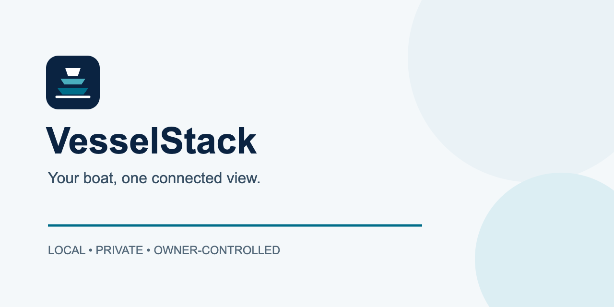
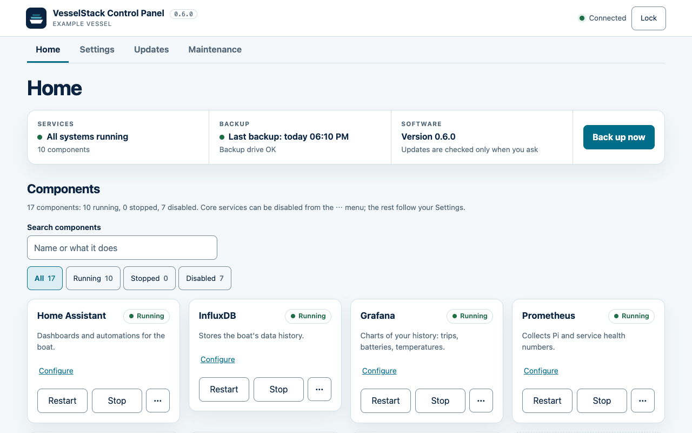
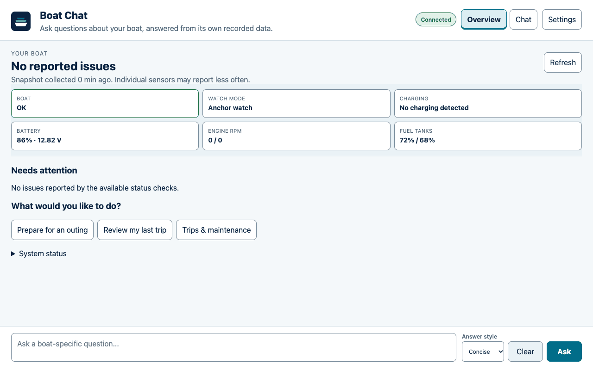
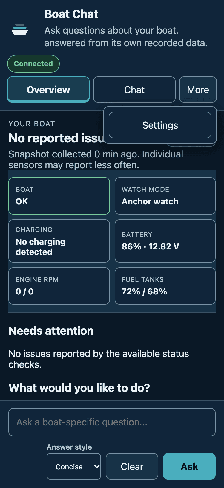
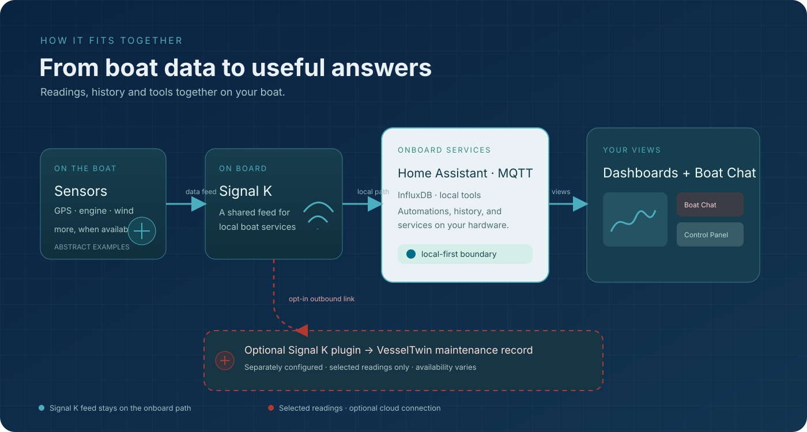
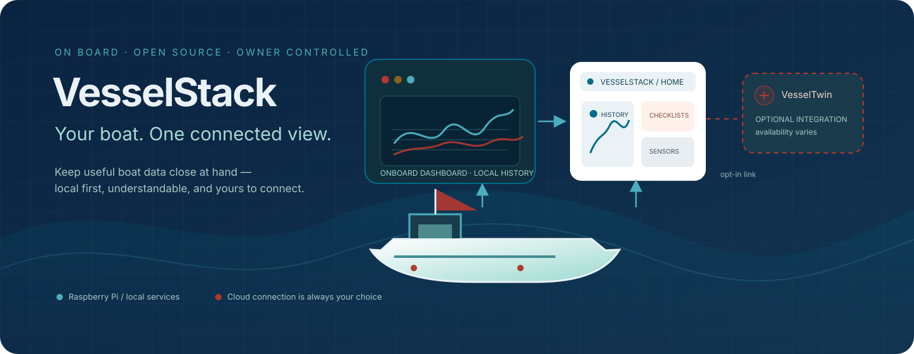

# VesselStack



VesselStack is a private, self-hosted companion for your boat. It keeps useful
boat data, dashboards, automation, and diagnostics together on a Raspberry Pi
you control—at home, in the lab, or aboard. It is designed to keep working on
the boat's local network when the internet is unavailable.

## Contents

- [What it looks like](#what-it-looks-like), [what you need](#what-you-need) and [where to go next](#where-to-go-next)
- [What you get](#what-you-get) and [optional integrations](#optional-integrations): VesselTwin and instrument displays
- [Quick start: one command on the Raspberry Pi](#quick-start-one-command-on-the-raspberry-pi), [before and after installation](#before-and-after-installation) and [manual guided installation](#advanced-manual-guided-installation)
- [Upgrading to 0.6.0](#upgrading-to-060)
- [First-run setup](#9-complete-first-run-setup): Home Assistant, Signal K, InfluxDB, Grafana, Boat Chat, Control Panel
- [MQTT access control](#mqtt-access-control), [network access](#reaching-vesselstack-from-other-devices) and [network security](#network-security)
- [Unattended operation and power](#unattended-operation-and-power): hardware watchdog, journal size cap, under-voltage warnings
- [Backups](#backups) (including [scheduled backups](#scheduled-backups)), [Updating](#updating), [Stopping or removing services](#stopping-or-removing-services)
- [Boat profile](docs/BOAT_PROFILE.md) for shared engine, battery, and tank configuration
- [Troubleshooting](#troubleshooting)
- [Developer validation](#developer-validation), [Documentation policy](#documentation-policy), [License and security](#license-and-security), [Moved sections](#moved-sections)

## What it looks like



*The Control Panel Home tab shows whether everything is running, the last backup and
whether an update is known. [Control Panel guide](docs/CONTROL_PANEL.md).*



*Boat Chat answers questions from your boat's own recorded data. Its Overview shows
condition and what needs attention. [Boat Chat guide](docs/BOAT_CHAT.md).*



*Both web apps work on a phone and follow the device's light or dark setting.*

## What you need

The reference build, from [docs/BOM.md](docs/BOM.md):

- Raspberry Pi 5 (8 GB; 4 GB is the minimum) with the Raspberry Pi Active Cooler.
- A 256 GB or larger high-endurance USB 3 SSD for the data disk.
- A dedicated, fused 12 V DC branch feeding an isolated or regulated marine
  supply that delivers a stable 5 V / 5 A to the Pi (the BOM allows a 10-32 V
  DC input).
- An NMEA 2000 interface, if you want boat data from the bus. A galvanically
  isolated interface is preferred; the PiCAN-M is field-proven on a boat but is
  not isolated and comes with grounding caveats.
- A separate backup drive, mounted outside the data disk.
- Optional: one Waveshare ESP32-S3-Touch-LCD-2.8C instrument display (a preview
  feature, see [Instrument displays](docs/DISPLAYS.md)).

A Raspberry Pi 4 also works, and a Debian or Ubuntu host with systemd is
supported. Setup needs the internet once; afterwards the stack runs on the boat
network without it.

## Where to go next

| I want to… | Read |
|---|---|
| Understand the hardware and buy parts | [Hardware bill of materials](docs/BOM.md) |
| Build a new Pi | [Hardware bill of materials](docs/BOM.md), then [Installation](docs/INSTALLATION.md) |
| Add VesselStack to an existing Pi | [Quick start](#quick-start-one-command-on-the-raspberry-pi), then [Getting started](docs/GETTING_STARTED.md) |
| Do first boot, SSH and token steps | [Getting started](docs/GETTING_STARTED.md) |
| Use or secure the Control Panel | [Control Panel](docs/CONTROL_PANEL.md) |
| Set up Boat Chat, units and timezone | [Boat Chat setup](docs/BOAT_CHAT.md), providers in [Boat Chat providers](boat-chat/README.md) |
| Reach dashboards from other devices | [Network access and security](docs/NETWORK.md) |
| Manage MQTT accounts and access lists | [MQTT access control](docs/MQTT.md) |
| Update, roll back, or install offline | [Updating](#updating), [Updating and offline install](docs/UPDATING.md) |
| Release to a lab Pi and an offline boat | [Deployment runbook](docs/DEPLOYMENT.md) |
| Connect VesselTwin | [VesselTwin integration](docs/VESSELTWIN.md) |
| Add ESP32 instrument displays | [Instrument displays (preview)](docs/DISPLAYS.md) |
| Develop, test, or cut a release | [Development guide](docs/DEVELOPMENT.md) |
| See every document | [Documentation index](docs/README.md) |

Power sources and instrument-reading coverage for Boat Chat are in
[Power monitoring](boat-chat/POWER_MONITORING.md).

## What you get

- A local view of boat data from Signal K-compatible sources and supported NMEA
  2000/SocketCAN hardware. An isolated NMEA 2000 interface is preferred (safest); a
  non-isolated one such as the PiCAN-M works with caveats; see the
  [hardware guide](docs/BOM.md).
- History and dashboards through InfluxDB, Grafana, MQTT, and Home Assistant.
- Boat Chat, a local diagnostic assistant with an optional provider you choose.
- A guided installer, backups, health checks, and an offline release path.

VesselStack is monitoring and diagnostics software. It is not certified
navigation, collision avoidance, engine control, or a sole alarm system.



### What runs locally



| Purpose | Local service or view | Typical use |
|---|---|---|
| Boat data | Signal K-compatible history and MQTT | Collect and share readings on the boat LAN |
| History | InfluxDB and Grafana | Explore trends and dashboards |
| Home automation | Home Assistant | Connect boat signals to automations |
| Diagnostics | Boat Chat | Ask questions about the data and system |
| Operations | Control Panel and `vesselstackctl` | Check health, configure, update, and back up |

Boat Chat defaults to a local provider. Other providers are optional and may
need internet access or their own credentials; VesselStack does not promise
that every provider works offline. The optional [instrument displays preview](docs/DISPLAYS.md)
is another separately enabled local feature.

### Component lifecycle

The Control Panel and `vesselstackctl` manage six core components—Home
Assistant, InfluxDB, Grafana, Prometheus, Mosquitto, and Homepage—as a
persistent catalog. Add or remove components without deleting retained data;
membership survives restarts, upgrades, and reinstalls. Review and apply
changes in the component view at `http://127.0.0.1:8780` through an SSH tunnel,
or use the corresponding `vesselstackctl` commands. Hardware and systemd
services remain configuration-driven. See [Control Panel lab testing](docs/CONTROL_PANEL_TESTING.md)
for acceptance steps.

### Lifecycle recovery

Applying a restore is a bounded transaction. VesselStack stages and validates
both application and data trees, journals the managed
systemd units, launchers, libexec helpers, update environment, and enable links
outside those trees, then stops services before swapping anything. If a later
swap, daemon reload, installer, or start fails, the old trees and journaled
managed paths are restored and a best-effort daemon reload/start is attempted;
failed trees and recovery materials are retained for inspection. If stopping the
running stack fails, no rollback is attempted under live services. Unrelated
`/etc` files, Docker services, AIS devices, and SocketCAN interfaces are not
removed. A restore still requires `--yes`, sufficient same-filesystem space,
and a verified archive; inspect and remove `*.pre-restore-*` only after health
checks pass.

### Shared lifecycle lock

`common/lifecycle_lock.py` provides the shared, non-blocking lock used by the
mutating installer, `vesselstackctl`, Control Panel operation slot, and detached
browser-update worker. It keeps the lock outside the application and data trees
and supports validated descriptor handoff to child processes. Read-only
`vesselstackctl` commands remain unlocked.
Direct boat-profile `set` and `init` commands use the same lock; in-process
profile-library writes remain the caller's responsibility.
Direct `deploy-chat.py` apply/rollback operations also use the shared lock;
read-only preview operations remain unlocked.
The real-systemd browser-update acceptance fixture copies these shared modules
alongside the panel so its service-start check exercises the same import set as
an installed release. The panel releases the shared lifecycle lock before handing
off its browser-update lock, so a detached updater cannot wake between those two
steps and report a spurious busy state.

## Optional integrations

These features are off or inert until you deliberately enable them. Neither is needed for the core stack.

### Optional VesselTwin connection

An optional VesselTwin connection uses the `signalk-vesseltwin` plugin, pairing,
and explicit reading opt-ins. Managed Docker/native Signal K modes preload the pinned
plugin by default (0.5.x lab prerelease); VesselStack does not enable, pair, or authorize readings for you.
See the [VesselTwin integration guide](docs/VESSELTWIN.md)
for setup and [VesselTwin](https://www.vesseltwin.io/) for maintenance documents,
equipment and logbook records.

### Instrument displays (preview)

Optional ESP32 touch-screen displays that show Signal K values (speed, depth, wind,
battery voltage and so on) on pages you define. The first supported board is the
Waveshare ESP32-S3-Touch-LCD-2.8C running ESPHome with LVGL. This is a preview and
the bridge service runs only when `DISPLAYS_ENABLE=true`.

```bash
sudo vesselstackctl display list
sudo vesselstackctl display status
```

Lifecycle commands are `vesselstackctl display list|add|remove|rotate|wifi|status|render|export|build|flash|deploy|themes|set-theme|catalog|show|set-pages|history|restore-config|serial-ports`.
See [Instrument displays (preview)](docs/DISPLAYS.md) for setup, firmware, layouts, the pinned ESPHome version and limitations, and [displays/README.md](displays/README.md) for the code layout.

Display colours come from `displays/themes.json`, which offers four themes: `classic` (the default and the original look), `high-contrast` (black with white values and a light tile border, for sunlight), `daylight` (light tiles with dark text) and `ocean` (navy tiles). Pick one per display:

```bash
sudo vesselstackctl display themes                  # list the themes (--json for the full palettes)
sudo vesselstackctl display set-theme helm daylight
sudo vesselstackctl display deploy helm --ota 192.0.2.50   # build if needed and upload in one step (or --serial DEVICE)
```

`display deploy ID (--ota HOST | --serial DEVICE)` builds only when the stored firmware is out of date and uploads it under one lock; it prints `STAGE:` lines with `--progress` and `To fix:` lines for known failures, and hides Wi-Fi and MQTT/OTA/API secrets in everything it prints. After every successful upload `build/displays/ID/last-flash.json` (root-only, never committed) records when, how and which image went to the screen. **Operational impact:** a deploy can take 3-6 minutes (10-15 minutes the first time, about 3 GB free disk). **Wi-Fi (OTA) updates have not been verified on hardware yet**; the first flash of a new display must be over USB, and USB is an equal option. To put the previous firmware back: `display restore-config STAMP` (see `display history`), then `display flash ID --previous --ota HOST` (or `--serial DEVICE`); see [Deploy and rollback](docs/DISPLAYS.md#deploy-and-rollback).

In the Control Panel, open **Displays → Edit theme and pages**, choose a page, and use its data picker to add instruments. Pick a source from the values Signal K is sending or select the catalog’s suggested source when no live reading is available. Gauges and tank bars use the range defined for the value. Previously configured values remain selectable when Signal K is offline. The editor reloads saved settings after a save, including when an earlier refresh is still running. The preview follows the draft as you change the layout or items. **Save** stores settings on the boat computer and keeps a backup. **Apply to screen** opens the upload dialog. If you have unsaved edits, **Save and upload** commits them before uploading, and cancelling keeps the draft open. For a first upload, connect the screen to the boat computer with a USB data cable. The picker prefers stable device names and can list validated USB serial devices without one. Wi-Fi updates remain unverified on hardware and sending firmware to a new address requires explicit confirmation.

**Verify** that **Save** keeps an edited page after refreshing the Displays tab. **Save** and **History → Restore** share the lifecycle lock with the display command, so either can finish when the boat computer is idle and both are refused during another lifecycle operation. After uploading, verify the updated pages and live readings on the physical screen. **Firmware sent** records the successful upload of the saved settings. Live readings also require the display bridge, a LAN-accessible MQTT broker, and a working connection from the screen. Backups, updates, and settings changes wait while the upload holds the lifecycle slot. A first build may need internet access and additional disk space.

**Rollback** through **History → Restore** and **Put previous firmware back** once the settings and credentials match the previous image. Before reverting to an older VesselStack version without theme support, run `set-theme ID classic`. See the [Control Panel Displays guide](docs/CONTROL_PANEL.md#displays).

`set-theme` writes `ui.theme` in `displays.json`; the change reaches the screen only after you rebuild and reflash that display. Night mode uses the same red palette on every theme and the alarm banner is never themed. `set-theme ID classic` removes the key and returns to the original colours. **Before downgrading VesselStack, run `set-theme ID classic` on every display that has a theme:** older versions reject the unknown `theme` key and the displays bridge then exits. A display left on `classic` generates exactly the firmware it did before, so nothing needs reflashing. The `high-contrast` warning tile is dark amber with white text (the old bright amber made its label unreadable); rebuild and reflash a display on that theme to get it. Details and limits are in [Themes](docs/DISPLAYS.md#themes).

**Choosing what a page shows.** The Control Panel's **Displays** tab lists your displays, shows whether the latest changes are on each screen (On screen, Changes not on screen, Never flashed, Not built, Unknown), a readiness checklist with the exact fix command for anything missing, each page's layout and items, an approximate preview of every page in the display's theme (Day/Night and severity switches, live values when Signal K has them), and a searchable list of the data a page can show. The tab also edits the theme and pages, saves, applies to the screen and restores older settings (see above); it runs the commands below (all JSON output, root for the ones that change anything), which you can also run yourself. Only `display add` and `display wifi` stay on the command line.

```bash
sudo vesselstackctl display list --json              # id, name, board and page count of every display
sudo vesselstackctl display catalog --live --json    # ~40 common values for your BOAT_UNITS, marked live or no_live_data
sudo vesselstackctl display show helm --json         # pages, layouts, preview boxes, revision, readiness (no secrets)
echo '{"pages":[{"title":"Nav","layout":"grid-2x2","items":["sog","depth"]}]}' | \
  sudo vesselstackctl display set-pages helm --if-revision "$(sudo sha256sum /opt/vesselstack/config/displays.json | cut -d' ' -f1)" --stdin
sudo vesselstackctl display history                  # backups of displays.json (newest 20)
sudo vesselstackctl display restore-config 20260101T120000Z
sudo vesselstackctl display serial-ports             # USB serial devices that `flash --serial` accepts
```

The data list (`displays/catalog.json`) offers 38 common Signal K values and 4 notifications with the right unit for `BOAT_UNITS` (`metric` or `us_customary`; the legacy `nautical` reads as metric). With `--live`, `catalog` makes one read-only request to your configured `SIGNALK_URL` (Bearer token only if `DISPLAYS_SIGNALK_TOKEN` is set, no redirects, 10 s in total, 4 MiB) to mark which values have data and to list other numeric values under "Uncatalogued"; it keeps only path, units, age and value of numeric leaves and never reads positions, destinations, MMSI, names, UUIDs or call signs, and it stores nothing. **Suggested alarm limits are shown but never applied by default**: an instrument with limits counts in the boat-wide alarm summary and can raise the alarm banner. `set-pages` refuses (exit 3) if `displays.json` changed since you read it (`--if-revision` is the sha256 of the file), refuses (exit 4) while a build or flash of that display runs, validates everything before writing, copies the previous file to `config/displays-backups/` (root-only, newest 20 kept, included in `vesselstackctl backup`) and restarts the displays bridge only when it reads something that changed. **Rollback:** `display history`, then `display restore-config STAMP` (refused with exit 2 if the backup has a different set of displays than the current `displays.json`: match them with `display add` / `display remove` first, then restore again, because restore does not touch MQTT accounts); rebuild and reflash the displays the command lists in `rebuild_needed`. Exit codes, JSON shapes and limits are in [Data catalog](docs/DISPLAYS.md#data-catalog) and [Editing pages, backups and restore](docs/DISPLAYS.md#editing-pages-backups-and-restore).

## Quick start: one command on the Raspberry Pi

**Headless is the normal case: the Pi needs no screen, keyboard or browser.** On a
Raspberry Pi running 64-bit Raspberry Pi OS (or Debian) with internet access, SSH into
it from your laptop (use `ssh -t` so the installer can ask its questions on that
session), run the pinned release installer and answer the questions in the same terminal:

```bash
ssh -t YOUR_USER@raspberrypi.local
curl -fsSL https://github.com/jclima/VesselStack/releases/download/v0.8.0/get-vesselstack.sh | sudo bash
```

The same release is also selected by `VESSELSTACK_VERSION=0.8.0` or `--version 0.8.0`:

```bash
curl -fsSL https://github.com/jclima/VesselStack/releases/download/v0.8.0/get-vesselstack.sh | sudo VESSELSTACK_VERSION=0.8.0 bash
curl -fsSL https://github.com/jclima/VesselStack/releases/download/v0.8.0/get-vesselstack.sh | sudo bash -s -- --version 0.8.0
```

> [!NOTE]
> The pinned URL names the release explicitly, so it installs exactly 0.8.0 whatever
> GitHub marks as Latest. The form `https://github.com/jclima/VesselStack/releases/latest/download/get-vesselstack.sh`
> points to whichever release GitHub marks Latest, which is not necessarily the newest
> one (every 0.5.x release was published as a prerelease, so that URL kept serving
> 0.4.4). Use it only when you want exactly that.

The installer checks the host before changing it. It may install Debian
prerequisites and, after asking, Docker Engine and Compose v2 from Docker's
official apt repository (signing-key fingerprint checked; details and undo steps are in
[the installation guide](docs/INSTALLATION.md#quick-path-one-command)). It then downloads and
checksum-verifies the release, asks for boat and service settings, and offers a final review
before starting VesselStack. `sudo` is required because installation writes system packages,
services, and `/opt/vesselstack`; the questions explain each change. Secrets are generated or
entered without echo and are not printed in the review. **32-bit Raspberry Pi OS (armhf) is
refused**: Docker Engine v28 was the last release for it. Re-flash with "Raspberry Pi OS
(64-bit)" in Raspberry Pi Imager (VesselStack supports Raspberry Pi 4 and 5);
`dpkg --print-architecture` must say `arm64`.

(Or paste the command into a terminal on the Pi itself. No address is opened and no
tunnel is needed.) The questions are grouped in short sections, each with a plain-language
explanation and a sensible default in `[brackets]`: **Enter** accepts the default, **?**
explains the question, **b** goes back one question, and a final review screen lists every
choice (never any secret) with *save*, *edit a section* and *quit*. A short example is in
[the installation guide](docs/INSTALLATION.md#quick-path-one-command). At the end the
installer prints the Grafana, Home Assistant and Boat Chat addresses, the command that shows
the Boat Chat access token, and the SSH tunnel command for the Control Panel. Everything
printed at the end is information only: nothing in the install needs a browser, and nothing is
opened for you.

For a boat with no internet, prepare the release and offline bundle in the lab and follow the
[offline deployment path](docs/DEPLOYMENT.md#simple-path-one-command).

Releases are built by the tag-triggered GitHub workflow (read-only build job, separate
write-only publish job, draft first, reproducible tarball on Linux); maintainers follow the
release checklist in [docs/DEVELOPMENT.md](docs/DEVELOPMENT.md#release-checklist). The recommended
way to sign release tags (key held in 1Password) is in
[docs/DEPLOYMENT.md](docs/DEPLOYMENT.md#1-release-signing-with-an-ssh-signing-key).
Release tags must be SSH-signed annotated tags: the release workflow runs
`scripts/verify-release-tag.sh` against `.github/allowed_signers` and refuses an unsigned,
lightweight or wrongly signed tag, a tag object whose own name differs from its ref, and a tag
that does not point at the exact commit being built, before building anything. To rotate the release key, change
`.github/allowed_signers` in a reviewed pull request to `main` first, then tag.

**No prompts at all** (scripts, a Pi without a terminal, repeatable installs):

```bash
# defaults, plus the settings you name (repeat --set; names as in vesselstack.example.env)
curl -fsSL https://github.com/jclima/VesselStack/releases/download/v0.8.0/get-vesselstack.sh \
  | sudo bash -s -- --yes --set BOAT_NAME=Foo --set SOCKETCAN_ENABLE=true
# every question's own default answer, nothing asked
curl -fsSL https://github.com/jclima/VesselStack/releases/download/v0.8.0/get-vesselstack.sh | sudo bash -s -- --defaults
# a ready-made vesselstack.env (optionally with --set overrides)
sudo bash get-vesselstack.sh --yes --config ./vesselstack.env --set BOAT_NAME=Foo
```

`--yes` answers yes to every question (Docker installation, final confirmation, upgrade of
an installed system) and takes the settings from `--config`, then `--set`, else the
defaults. `--defaults` gives every question its own default instead: it installs Docker
and VesselStack on a fresh Pi, but leaves an installed system alone (the upgrade question
defaults to no) and never removes conflicting Docker packages. With neither, and no
terminal to ask on (for example `curl | sudo bash` over `ssh` without `-t`), the installer
stops before changing anything and lists these options.

If you run the guided installer with `--web-wizard`, return to its terminal after saving in the browser. The installer picks up the configuration and continues there.

### Headless Raspberry Pi: open the panel from your laptop

Use Raspberry Pi Imager to prepare **Raspberry Pi OS Lite (64-bit)**. In its
customization screen, set a hostname, username, password and Wi-Fi details, and
turn on SSH. Boot the Pi, then connect once from your laptop with
`ssh -t YOUR_USER@YOUR_PI.local` (use the Pi's router-assigned IP if the name does
not resolve). You do not need a screen, keyboard or SSH tunnel on the Pi.

Run the guided installer above in that terminal. In **Who can reach what**, the
question **Control panel listens on** defaults to **this Pi only (SSH tunnel)**. Keep
that answer: it is the recommended setting. The installer ends by printing the tunnel
command; run it on your own computer, open `http://127.0.0.1:8780`, and paste the
panel token into **Unlock**:

```bash
ssh -L 8780:127.0.0.1:8780 YOUR_USER@YOUR_PI.local
sudo grep '^CONTROL_PANEL_TOKEN=' /opt/vesselstack/config/control-panel.env
```

Reaching the panel directly over the boat network is an opt-in choice for a trusted
lab or boat LAN: answer **trusted network (token required)** instead, or apply it to an
installed system with this command and use the address it prints:

```bash
sudo vesselstackctl panel-access lan
sudo grep '^CONTROL_PANEL_TOKEN=' /opt/vesselstack/config/control-panel.env
```

The command restarts only the Control Panel. It preserves its token and port and
does not change any other service's listener or firewall rules. Use the address it
prints; `0.0.0.0` is a listen setting, not a browser address. Check the current
setting with `sudo vesselstackctl panel-access`. To undo network access:

```bash
sudo vesselstackctl panel-access local
```

For unattended **fresh installs**, `--panel-lan` is shorthand for
`--set CONTROL_PANEL_HOST=0.0.0.0`. Combine it with `--set LAN_ACCESS=local` to keep
the preset-managed dashboards and databases local. `LAN_ACCESS=local` does not
restrict Signal K's host-networked listener; see the network limitations below.
The panel option alone leaves every other network setting unchanged. For upgrades,
use `panel-access lan` after updating instead of passing configuration overrides
to the installer.

Network access binds the panel to **all IPv4 interfaces**. Use it only on a trusted
lab or boat network: its token is still required, but ordinary HTTP does not encrypt
administration traffic. Do not forward this port from the internet. An enabled
strict firewall may need an explicit rule for the panel port on the relevant
interface; setup never silently opens firewall ports. Local-only (SSH tunnel) is the default and the recommendation.

The guided installer explains each step in plain language and asks before it
does anything beyond installing ordinary Debian packages:

1. checks the computer (Linux, root, Debian family, 64-bit ARM; warns, does not
   fail, on other systems), disk space, memory and internet access, and detects an
   existing installation (an existing install is **never overwritten silently**: it
   is offered the built-in `vesselstackctl update` upgrade, with its backup);
2. installs the packages VesselStack needs with `apt-get` (`ca-certificates curl jq
   openssl python3 python3-venv rsync tar gzip`; no `git`) and, if Docker Engine or
   the Compose v2 plugin is missing, **asks** before adding Docker's official apt
   repository (key fingerprint checked) and installing `docker-ce docker-ce-cli
   containerd.io docker-buildx-plugin docker-compose-plugin` (details and undo steps in
   the Docker box above; conflicting unofficial packages are only removed after you
   confirm, 32-bit Raspberry Pi OS is refused);
3. downloads `vesselstack-<version>.tar.gz` and its `.sha256` from the GitHub
   release, verifies the checksum, refuses unsafe archives (absolute or `..` paths,
   links, devices, setuid bits) and unpacks to `/opt/vesselstack-release/<version>`,
   owned by root and not writable by others;
4. asks the configuration questions **in the terminal** (the terminal wizard,
   `vesselstack-wizard.py --cli`, the default). It reads your answers from the terminal
   (`/dev/tty`, so the piped `curl | sudo bash` form works), validates every answer
   immediately, and offers sections for the boat (name, type, units, timezone detected
   from the system, optional and private MMSI, call sign, length and beam), Signal K
   (docker, existing or native; docker recommended), NMEA 2000 / CAN (`SOCKETCAN_ENABLE`,
   interface, bit rate and the home-lab virtual-CAN option `VESSELSTACK_CAN_CREATE_VCAN`),
   AIS, Home Assistant (URL, optional hidden token), Boat Chat provider (default `local`)
   and Telegram, the firewall (untrusted interface, enable, strict mode, allowed ports),
   raw-data retention (`INFLUXDB_RAW_RETENTION`; empty means 30 days on a new install and no
   change to an existing database) and who can reach the dashboards (`local`, `dashboards`
   or `all`; see "Reaching VesselStack from other devices"). Ports, container and bucket
   names, folders, the service account and the generated secrets sit behind "Advanced
   settings? [y/N]". Passwords and tokens default to being generated during installation, are
   read without echo when you do type one and are never printed or logged. It never turns
   hardware on by itself. The terminal wizard has no network surface. The optional browser
   wizard (`--web-wizard`) serves loopback only and cannot be combined with `--config`,
   `--set` or `--defaults`. How the wizards validate, stage and install the file is described
   in [Development: wizard internals](docs/DEVELOPMENT.md#wizard-internals);
5. shows a summary of the chosen configuration (no secrets), asks for confirmation,
   runs `install.sh --dry-run`, then `install.sh --start`, then `vesselstackctl
   doctor`, and prints `vesselstackctl urls` plus, as plain text, the service
   addresses to use from another computer (host name or IP), the command that shows
   the Boat Chat access token and either the panel network address or its local-only access hint
   (information only), where the generated tokens are stored and the next steps.
   It ends with a list of everything it changed.

Options (`sudo bash get-vesselstack.sh --help`): `--yes` (ask nothing, answer yes),
`--defaults` (ask nothing, each question's default), `--panel-lan` (share only the
panel listener on a fresh install), `--set KEY=VALUE` (repeatable;
avoid secrets here, they would show in the process list: leave them to be generated),
`--config FILE` (use an existing `vesselstack.env`; `--no-wizard --config FILE` is the
same), `--cli` / `--terminal` (the default terminal questions), `--web-wizard` (optional
browser wizard), `--version X.Y.Z`,
`--offline --bundle DIR [--tarball FILE]` (no internet, see
[Offline install](#offline-install-no-internet-on-the-boat)), `--sha256 HASH`
(pin the tarball to a checksum you obtained elsewhere), `--dir DIR`,
`--wizard-port N` (browser wizard only). `--set` values are checked early for shape and
fully (key, characters, enum, ranges) by the wizard before `install.sh` runs; an unknown
key or invalid value stops the installer without installing anything (Debian packages
and Docker may already have been installed by the earlier steps; re-running is safe).
`--set` cannot change the configuration of an installed system (an upgrade keeps it).
With a saved configuration from an earlier run, `--yes` and `--defaults` reuse it and
`--set` is applied on top of it (the old file is kept as `vesselstack.env.previous`). Re-running is safe: finished steps are reported
and skipped, an already installed version just reports "nothing to do". Rollback of this
installer change: use the previous release's `get-vesselstack.sh`; nothing else changed.

**What `curl | sudo bash` trusts.** It runs a script downloaded from GitHub as
root. You are trusting GitHub, TLS (the script enforces HTTPS with TLS 1.2+ for the
downloads) and the VesselStack release you fetch it from. The tarball's `.sha256`
is published in the *same* release, so it protects against corruption and partial
downloads but not against a compromised release or account: compare the printed
sha256 with the one on the GitHub release page, or pass `--sha256`. The whole
script is wrapped in functions and ends with a single `main "$@"` call, so a
truncated download cannot half-run. If you prefer to read it first (recommended):

```bash
curl -fsSLO https://github.com/jclima/VesselStack/releases/download/v0.8.0/get-vesselstack.sh
curl -fsSLO https://github.com/jclima/VesselStack/releases/download/v0.8.0/get-vesselstack.sh.sha256
sha256sum -c get-vesselstack.sh.sha256
less get-vesselstack.sh
sudo bash get-vesselstack.sh
```

The script is `scripts/get-vesselstack.sh` in this repository; each release ships
a copy with that release's version baked in as the default, plus
`get-vesselstack.sh.sha256`. Rollback: nothing outside the listed changes is
touched; `sudo vesselstackctl stop` stops the services and the README's
[uninstall](#stopping-or-removing-services) and restore sections cover the rest.
Releases are unpacked next to each other and never deleted; remove
`/opt/vesselstack-release/<version>` yourself when you no longer need it.

## Advanced: manual guided installation

Prefer to run each step yourself? After installing the OS and Docker prerequisites
from the end-to-end guide:

```bash
git clone https://github.com/jclima/VesselStack.git
cd VesselStack
git checkout v0.8.0
python3 vesselstack-wizard.py --cli     # terminal questions (no browser)
# python3 vesselstack-wizard.py        # or the optional browser wizard
```

The terminal wizard (`--cli`) asks in the terminal and writes `vesselstack.env`; add
`--defaults` and `--set KEY=VALUE` to configure without questions, `--base FILE` to start
from an existing file, and `--validate FILE` to check an existing env file with the wizard's
rules (exit 0 if valid, 1 otherwise, no server started). The browser wizard walks seven steps
(Preflight, Hardware, Vessel, Storage, Signal K, Network, Review); Back keeps your choices and
Continue stays blocked until the page has its address token. It prints a per-run
loopback address of the form `http://127.0.0.1:PORT/#token=...`; open that exact address, on
the Pi or through an `ssh -L` tunnel. Both wizards write a private `vesselstack.env` and
change nothing else: no boot firmware, firewall rules, marine wiring or services. The browser
wizard's options, token handling and request protections are described in
[Development: wizard internals](docs/DEVELOPMENT.md#wizard-internals). When the browser wizard
saves the file, its last page shows the commands to run next (a `--dry-run` check, then
`--start`, then `sudo vesselstackctl doctor`) and the wizard may then stop by itself, which is
expected. Run `sudo ./install.sh --config vesselstack.env --dry-run` and `--start` as described
in the sections below. The pages are shown with screenshots in [Getting started](docs/GETTING_STARTED.md#the-optional-browser-wizard).

Rollback: delete the generated `vesselstack.env`; if a browser-wizard run was killed with
SIGKILL, remove its temporary account with `sudo userdel vesselstack-wizard`.

> [!WARNING]
> VesselStack is not certified navigation, collision-avoidance, engine-control,
> alarm, or life-safety equipment. Maintain independent marine instruments and
> alarms. Never depend on this software as the sole source of safety data.

## Before and after installation

Before installation, decide where the Pi will live, how it will be powered,
and whether its data disk and backups are separate from the boot media. If you
connect to NMEA 2000, confirm the bus is correctly powered and terminated and
that you have chosen the interface and its power source deliberately
(an isolated interface is preferred (safest); a non-isolated one such as the
PiCAN-M works with caveats, see docs/BOM.md). Commission on the bench first.

After installation, use the printed URLs from a trusted local device, run
`sudo vesselstackctl doctor`, and confirm the dashboards show the signals you expect.
Keep the generated credentials per host, back up to a separate device (turn on scheduled
backups with `VESSELSTACK_BACKUP_SCHEDULE`, see [Scheduled backups](#scheduled-backups), or run
`sudo vesselstackctl backup` yourself), and test restoring one before relying on the system. Read the deployment guide
before carrying an update to a boat without internet access.

VesselStack 0.8.0 includes configurable Homepage branding and fixes for the Displays editor. Upgrade from 0.7.0 or 0.7.1 with the
full installer or `vesselstackctl update` so shared modules, configuration and
services are updated together; the application-only updater is not sufficient for
this release. The installer takes a verified backup first. If rollback is needed,
verify and restore that backup rather than downgrading. Database changes are
additive columns only; historical samples without verified source timestamps remain
excluded from inferred-energy calculations. The 0.7.0 reliability-validation runbook
below is retained as historical release context; 0.6.3 was promoted after physical
Pi acceptance, while 0.6.2 was marked Latest directly.

## Upgrading to 0.6.0

Read this before updating an installed system. Update from [Updating](#updating) with a backup
on a mounted external drive, not while underway. This section applies to 0.6.0, 0.6.1, 0.6.2, 0.6.3 and 0.6.4.

**Settings that say `BOAT_UNITS=nautical` (fixed in 0.6.1).** Older setup wizards offered
"nautical" as a units choice, and installers before 0.5.7 did not check it, so such a
`vesselstack.env` may exist. 0.6.0 refused it with `BOAT_UNITS must be us_customary or metric`
and stopped the update before changing anything. From 0.6.1 the installer reads `nautical` as
`metric` (metres for depth; knots and nautical miles are kept in both systems), prints one
`Note:` line, and a real install or update rewrites `vesselstack.env` with `BOAT_UNITS=metric`
(a dry run only prints the note). The setup wizard and the Control Panel also show it as Metric
without changing it. Any other unsupported value is still refused before anything is changed,
now with a message naming the file and the fix. If you are stuck on 0.6.0, change the value
by hand and run the update again:

```bash
sudo sed -i 's/^BOAT_UNITS=.*/BOAT_UNITS=metric/' /opt/vesselstack/config/vesselstack.env
```

**Backup drive not mounted (0.6.1).** When the backup folder is under `/media` or `/mnt` and the
drive is not mounted, `get-vesselstack.sh` and (from an installed 0.6.1) `vesselstackctl update` and
`vesselstackctl backup` no longer just stop: before anything is stopped or changed they ask
whether to mount the drive from `/etc/fstab`, pick a connected USB drive, check again, or back up
to the system disk once. See [Backups](#backups). A direct `sudo vesselstackctl update <dir>` run
from an installed 0.6.0 or earlier controller does not show this menu (that controller is older
than the fix); use `get-vesselstack.sh`, or mount the drive first, or run
`sudo env VESSELSTACK_BACKUP_ALLOW_UNMOUNTED=true vesselstackctl update <dir>` to back up to
the system disk once.

**Backup drive not mounted, from the Control Panel (0.6.2).** The Control Panel can now resolve this
itself, for that one request: **Back up & install** and **Back up & update from folder** check the
backup folder first and, when the drive is not mounted, show a dialog to mount it from `/etc/fstab`,
mount a listed USB drive, back up to the system disk once, use a different backup folder, or install
without a backup. See [Backups](#backups). This cannot help the upgrade that delivers it: the
worker uses the controller that is already installed, so for the upgrade to 0.6.2 mount the drive by
hand or run the update from a terminal. Rollback: unmount with `umount`; nothing is written to
`/etc/fstab` or `vesselstack.env`.

**Instrument displays (0.6.2, preview, optional).** The Control Panel **Displays** tab can edit pages
and themes and apply them to a screen over USB or Wi-Fi (see [Instrument displays](#instrument-displays-preview)).
An install that does not enable displays is unaffected. Wi-Fi (OTA) updates are not yet verified on
hardware; flash each display over USB first. **Before downgrading below 0.6.2**, run
`sudo vesselstackctl display set-theme ID classic` for every themed display, otherwise the displays
bridge exits with status 2 on the older version (it rejects the `theme` key). Rollback of display
settings: `sudo vesselstackctl display restore-config STAMP`, then `display flash ID --previous`.

**Homepage front door and easier sign-in (0.6.3).** Homepage replaces Heimdall on port 80
(`HOMEPAGE_PORT`; `HEIMDALL_PORT` is migrated when `HOMEPAGE_PORT` is unset). Updating stops and removes the
`vesselstack-heimdall` container and image and prints a notice; `$VESSELSTACK_DATA/heimdall` is left on disk.
Tiles follow the enabled components; add your own in `config/homepage-custom/`. If you restrict the firewall
by hand, allow port 80 from trusted interfaces only; port 443 is no longer published. The Control Panel and
Boat Chat can now be unlocked with a passphrase, optionally remembered on a device for 30 days, or by a
pairing link or QR code (`sudo vesselstackctl panel-link [--for panel|chat]`); see the sign-in sections
below. Existing long tokens and access/admin codes keep working. Passphrase sign-in is off until a
passphrase is set. Rotating a token signs out the devices issued under the old value. The panel and Boat Chat
use plain HTTP on the LAN, so a passphrase or pairing link can be seen by anyone who can watch that
network; use a trusted LAN only. Rollback: reinstall 0.6.2 with its pinned installer (Homepage is replaced
by Heimdall only on that reinstall; older versions ignore the sign-in store files). Before downgrading
below 0.6.2, run `sudo vesselstackctl display set-theme ID classic` for every themed display.

**Updating to 0.6.3 from an older version can end with a shell error (known issue).** Releases up to 0.6.3 rewrote `/usr/local/sbin/vesselstackctl` in place while the older `vesselstackctl update` (or the
pinned installer, which starts it) was still running, and that older script is read from disk as it runs. When
the installer finished, the old command carried on reading the new file from its old position and could print
`/usr/local/sbin/vesselstackctl: line N: syntax error near unexpected token ...` after the installer's final
`Control panel:` line. **The install has completed**; the message comes from the old command after the work is
done. Do not restore a backup because of it. To verify:

```bash
cat /opt/vesselstack/config/installed-version     # 0.6.3
sudo vesselstackctl doctor
sudo vesselstackctl status
```

Restore only if one of these fails. The 0.6.4 installer writes the new file beside the
old one and renames it into place, so a running older command keeps its own copy and the message cannot
happen on later updates. **Operational impact:** none at runtime; only the final message of the update is affected, and the installed command is the
correct 0.6.3 one. **Rollback:** this note changes nothing to roll back. If you need to leave 0.6.3, downgrades are refused, so restore the verified pre-update backup as described under Rollback below.

Rollback: set `BOAT_UNITS` back to `us_customary` (or `metric`) in the same file. 0.6.1
needs no other manual step.

**Fix it at the prompt (0.6.1).** When you run the installer, an update or the pinned
`get-vesselstack.sh` from a terminal (for example over `ssh -t`), an unsupported `BOAT_UNITS`
value, or a setting in `vesselstack.env` that cannot be written safely (see below), no longer
just stops the run. The installer asks what to do before changing anything else:

```text
BOAT_UNITS in /opt/vesselstack/config/vesselstack.env is "imperial", which is not supported.
  [1] US customary (feet, °F, psi, US gallons)
  [2] Metric (metres, °C, kPa, litres)
  [c] Cancel (nothing is changed)
Choice:
```

An unsafe value (a token or other setting with an apostrophe plus a backslash, double quote,
dollar sign or backtick, a line break, or a control character) is offered as
`[1] Enter a new value for <KEY>`; what you type for a token, password or key is hidden and is
never printed or logged, and a replacement that is still unsafe is refused. Your answer is saved
in the settings file, the installer prints `Changed <KEY> in <file> (previous copy: <file>.before-fix-<time>)`
and starts over with the same options. The previous copy is root-only; delete the
`*.before-fix-*` copies once the install works. `c`, an empty answer at the end of input or
five minutes without an answer prints `Cancelled. Nothing was changed.` and leaves the file as
it was. Limits: only settings written in the file you pass with `--config` are offered (a value
that comes from the environment is not), generated or preserved passwords and tokens (InfluxDB,
Grafana, MQTT, Boat Chat, Control Panel) are never offered because the running services still hold the
old value (change it in the service first, then edit the file), and a symbolic link, a file not
owned by root, a file in a folder (or under a parent folder) that other users can change, or a
file whose edit cannot be verified is left untouched. For an unsupported units value the manual
`sed` command is printed; for an unsafe value you are told to edit the setting by hand. Runs without a terminal (cron, a service, the Control Panel, `--yes`,
`VESSELSTACK_NONINTERACTIVE=true`) never ask: they stop before changing anything and print the
exact fix, as in 0.6.0. A dry run that you answer does save the fix you chose.

**What changes for an existing boat**

- **Env-file values are checked more strictly.** The installer refuses a value that holds an
  apostrophe together with a backslash, a double quote, a dollar sign or a backtick, and any
  multi-line value, in the settings it writes to `vesselstack.env`, `boat-chat.env` and
  `control-panel.env`. A boat name such as `Skipper's "Dream"` is affected; `Skipper's Dream`
  is not. The check now runs first: before anything is changed, and also under `--dry-run`, and
  it covers preserved and generated secrets too. The installer also deletes stale
  `.vesselstack.env.*`, `.boat-chat.env.*` and `.control-panel.env.*` temp files from `config/`
  (left by a killed run) before writing; no other file is touched.
- **`GET`, `HEAD` and `POST /api/settings` require the Boat Chat access code.** A bookmark,
  script or dashboard that read or saved settings without it now receives an authentication
  error. Where an admin code is configured, `POST` needs that too. Scripts that call `POST
  /api/settings` must send the access code, and, when it differs from the admin code, the new
  optional `X-Boat-Chat-Access-Token` header carries it on `GET`, `HEAD` and `POST`. The access
  code cannot be cleared through the API (blank or `null` returns 400) unless
  `BOAT_CHAT_ALLOW_OPEN=true`. The environment variable names
  (`BOAT_CHAT_ACCESS_TOKEN`, `BOAT_CHAT_SETTINGS_TOKEN`) are unchanged.
- **Unauthenticated loopback settings writes require a local `Host` name** (a defense
  against DNS rebinding). Reach Boat Chat through `127.0.0.1` or `localhost`, or send the
  token.
- **The Control Panel looks different.** It now has four tabs (Home, Settings, Updates,
  Maintenance). **Install & start** is **Reinstall & start** and **Run preflight** is **Check
  setup**, both under Maintenance → Setup & repair, and they run the same commands as before.
  Saving settings and applying them are two steps (**Save**, then **Apply**). The Updates tab
  contacts GitHub only when you press **Check for updates**. Stored settings and keys are
  unchanged. Boat Chat's credentials are labelled **Access code** and **Admin code**; the
  variable names are unchanged.
- **The Control Panel checks a few settings as you save.** The timezone must be a valid IANA
  name such as `Europe/Lisbon` (some legacy aliases such as `US/Eastern` may be rejected on
  newer systems where they moved to the `tzdata-legacy` package). Boat length must be more
  than 0 and at most 500, beam more than 0 and at most 100 (plain numbers in metres, no
  units), and CAN speed a whole number from 10000 to 1000000. The checks apply only to fields
  you edit, so an existing saved value you do not touch is never rejected or cleared; errors
  appear next to the field.
- **Docker Signal K may restart once.** If the update newly preloads the pinned
  `signalk-vesseltwin` 0.2.3 plugin into an already-running Signal K container, the
  installer restarts that container so the plugin loads. An existing preloaded copy is never
  overwritten. Plan for a short gap in Signal K data.
- **Coming from 0.4.x:** update once from the CLI with the pinned installer. Since 0.5.0
  Mosquitto always enforces an access list, so the first update recreates the broker once, and
  MQTT users you added by hand to the old password file lose access unless you add them
  through VesselStack (see [MQTT access control](docs/MQTT.md)).

**Env-file values are checked before anything changes.** `sudo ./install.sh --config FILE
--dry-run`, and therefore `vesselstackctl update` and the Control Panel updater (both run a dry
run first), refuse an unsafe value before the backup is taken, services are stopped or any file
is touched. The installer lists each offending setting by key name only (never the value), says
why, and exits with an error:

```text
  BOAT_NAME: a single quote combined with a backslash, double quote, dollar sign or backtick
Refusing to continue: the settings above cannot be written safely to the environment files.
```

Edit that value (for example `BOAT_NAME` in the Control Panel or `vesselstack.env`) so it no
longer combines an apostrophe with one of those characters or spans lines, then run the dry
run or the update again. Env files are also written atomically (to a temporary file that
replaces the old one only when complete), so a failed run leaves the previous file intact. If an
older release left an update stopped on this problem, restore the pre-update backup with the
command under Rollback below, fix the value, and update again.

**Verify after updating**

```bash
cat /opt/vesselstack/config/installed-version     # 0.7.0
sudo vesselstackctl doctor                        # RESULT healthy
sudo vesselstackctl status
```

Open Boat Chat and the Control Panel, and confirm the dashboards show live values.

**Rollback.** Downgrades are refused (`Downgrade from 0.7.0 to ... is not supported`). Restore the
verified pre-update backup instead:

```bash
sudo vesselstackctl verify-backup /path/to/vesselstack-TIMESTAMP.tar.gz
sudo vesselstackctl restore /path/to/vesselstack-TIMESTAMP.tar.gz --yes
```

The restore keeps the previous trees as `*.pre-restore-STAMP` until you delete them (see
[Backups](#backups)).

## What VesselStack installs

| Component | Purpose | Default address |
|---|---|---|
| Home Assistant | Automations, dashboards, notifications | `http://HOST:8123` |
| InfluxDB 2.9 | Time-series storage | `http://HOST:8086` |
| Grafana 13 | Historical dashboards | `http://HOST:43000` |
| Prometheus | Infrastructure metrics | `http://HOST:9090` |
| Mosquitto | Authenticated MQTT broker | `HOST:1883` |
| Homepage | Boat front door: tiles for every enabled service | `http://HOST` |
| Boat Chat | Telemetry-backed diagnostic assistant | `http://HOST:8765` |
| Control Panel | Component installation, configuration, and lifecycle | `http://127.0.0.1:8780` |
| Displays bridge (opt-in, `DISPLAYS_ENABLE=true`) | Publishes configured Signal K instruments to MQTT for instrument displays | systemd service `vesselstack-displays-bridge`; no listener |

The installer generates credentials, renders a pinned Docker Compose stack,
creates a confined systemd service for Boat Chat, creates configurable InfluxDB
buckets, provisions the one-minute downsample task expected by Boat Chat,
provisions Grafana datasources and the system-health and boat-overview dashboards, and installs the
`vesselstackctl` lifecycle command. It also installs a local-first, token-
authenticated Control Panel that can inspect and operate every managed
container and host service, edit redacted configuration, check the setup, save and apply
settings, create backups, and check for and install release updates.

All container tags are release-pinned and checked for Linux ARM64 availability;
VesselStack does not rely on floating `latest` tags.

The installer supports an existing Signal K server, an opt-in
pinned Signal K container, or an opt-in pinned native Signal K installation. It
also provides hardware-probed SocketCAN and AIS-catcher modules. Hardware
modules remain disabled unless explicitly configured. It also includes generic
Home Assistant alert/dashboard templates and an optional untrusted-interface
firewall policy.

## Supported platform

- Raspberry Pi 4/5 with Raspberry Pi OS 64-bit, or Debian/Ubuntu with systemd
- At least 4 GB RAM; 8 GB recommended for the full stack
- SSD or NVMe storage strongly recommended
- Docker Engine with Docker Compose v2
- Python 3 with `venv`
- Existing Signal K server or a selected VesselStack Signal K install mode
- Dedicated non-root service account

Installation downloads container images and a Python dependency, so temporary
internet access is required.

## Before installation

1. Back up existing Home Assistant, InfluxDB, Grafana, MQTT, and Signal K data.
2. Confirm ports `80`, `443`, `1883`, `8086`, `8123`, `8765`, `8780`, `9090`,
   and `43000` are free. Port `8780` binds to loopback by default.
3. If using `SIGNALK_MODE=existing`, confirm Signal K responds:

   ```bash
   curl -fsS http://127.0.0.1:3000/signalk
   ```

4. Put `/opt/vesselstack-data` on SSD/NVMe storage.
5. Do not deploy while underway or while relying on the computer for an anchor
   watch or alarm.

## 1. Install prerequisites

On Raspberry Pi OS or Debian/Ubuntu:

```bash
sudo apt update
sudo apt install -y ca-certificates curl git jq openssl python3 python3-venv
```

Install Docker Engine and Compose v2 from Docker's official apt repository
(<https://docs.docker.com/engine/install/debian/> for 64-bit Raspberry Pi OS and
Debian), or let the one-line installer do it (see "Quick start" above).

```bash
sudo docker version
sudo docker compose version
```

Do not combine installation with a broad OS upgrade. Treat OS/kernel upgrades
as separate maintenance with a separate rollback plan.

## 2. Create the service account

The default configuration uses a locked `boat` account:

```bash
sudo useradd --system --create-home \
  --home-dir /var/lib/vesselstack \
  --shell /usr/sbin/nologin boat
```

If it already exists, keep it and set `VESSELSTACK_USER` accordingly. It does
not need membership in the `docker` group.

## 3. Download VesselStack

```bash
git clone https://github.com/jclima/VesselStack.git
cd VesselStack
```

To work from the 0.8.0 release, check out its tag:

```bash
git fetch --tags
git checkout v0.8.0
```

`v0.8.0` includes the Homepage and Displays updates; see the [CHANGELOG](CHANGELOG.md). Once
the signed release tag exists, verify it yourself (needs `ssh-keygen`, which ships
with OpenSSH):

```bash
git fetch --tags
scripts/verify-release-tag.sh v0.7.0
# maintainers and owners: also bind the tag to the commit you recorded when it was built
# (the full 40-character SHA from your release notes, not one read back from the tag itself)
scripts/verify-release-tag.sh v0.7.0 .github/allowed_signers "$RECORDED_COMMIT"
# equivalent plain git command:
git -c gpg.format=ssh -c gpg.ssh.allowedSignersFile=.github/allowed_signers verify-tag v0.7.0
```

The script prints the signer and key fingerprint, and exits non-zero for an unsigned,
lightweight or wrongly signed tag. The release key fingerprint is
`SHA256:01UcXtAoMkJ7zfQ2n7gIc4fUjPa3+0BVvHJ2VHIuTIw`. Older tags (`v0.5.x`) are unsigned and
fail this check by design.

## 4. Configure the vessel

```bash
cp vesselstack.example.env vesselstack.env
chmod 600 vesselstack.env
nano vesselstack.env
```

| Setting | Description |
|---|---|
| `BOAT_NAME` | Name displayed by Boat Chat |
| `BOAT_TYPE` | Vessel make/model or general type |
| `BOAT_MMSI`, `BOAT_CALLSIGN` | Optional identity fields |
| `*_PORT` | Host ports for Grafana, the Homepage front door (`HOMEPAGE_PORT`, default 80), InfluxDB, Prometheus, MQTT, and AIS |
| `VESSELSTACK_DATA_BIND_ADDRESS` | IPv4 address InfluxDB, Prometheus and MQTT publish on; default `127.0.0.1` (this device only) |
| `VESSELSTACK_WEB_BIND_ADDRESS` | IPv4 address Grafana and Homepage publish on; default `0.0.0.0` (LAN dashboards), `127.0.0.1` to restrict |
| `HOMEASSISTANT_BIND_ADDRESS` | IPv4 address Home Assistant (host-networked, `8123`) listens on; default `0.0.0.0`. Any other value makes the installer manage one delimited `http:` block in `${VESSELSTACK_DATA}/homeassistant/configuration.yaml` (see "Reaching VesselStack from other devices"). Signal K has no equivalent setting |
| `BOAT_CHAT_ACCESS_TOKEN` | `GENERATE` (default) creates a random token, preserved on re-install; required for chat, status and data APIs |
| `INFLUXDB_CONTAINER_NAME` | Advanced override for existing/custom Compose deployments |
| `BOAT_TIMEZONE` | IANA timezone, such as `America/Los_Angeles` |
| `BOAT_UNITS` | `us_customary` or `metric` (the legacy value `nautical` is read as `metric`; case and surrounding spaces are ignored) |
| `VESSELSTACK_USER` | Existing non-root service account |
| `VESSELSTACK_UID`, `VESSELSTACK_GID` | Derived from the service account by the installer |
| `VESSELSTACK_ROOT` | Application path; default `/opt/vesselstack` |
| `VESSELSTACK_DATA` | Persistent container-data path |
| `VESSELSTACK_BACKUP` | Backup destination; must be outside the application and data trees |
| `SIGNALK_MODE` | `existing`, `docker`, or `native` |
| `SIGNALK_VERSION` | Pinned Signal K release used by managed modes |
| `SIGNALK_URL` | Existing Signal K endpoint |
| `SIGNALK_VESSELTWIN_PRELOAD` | Managed Docker/native modes preload immutable `signalk-vesseltwin` 0.2.3 (default `true`); existing mode ignores it, and `false` skips without uninstalling |
| `SIGNALK_DATAPATH_AUTOCONFIG` | Managed Docker/native modes install `signalk-to-influxdb2` 2.3.0, add the NMEA 2000 provider and write the plugin's InfluxDB configuration (default `true`, see [Signal K and InfluxDB](#signal-k-and-influxdb)); existing mode ignores it, and `false` skips without removing anything |
| `HOME_ASSISTANT_TOKEN` | Optional long-lived token used by Boat Chat |
| `SOCKETCAN_ENABLE` | Opt in only after the CAN interface is present |
| `SOCKETCAN_INTERFACE`, `SOCKETCAN_BITRATE` | CAN device and NMEA 2000 bitrate (`vcan*` interfaces ignore the bitrate) |
| `VESSELSTACK_CAN_CREATE_VCAN` | `true` creates a missing `vcan*` interface at boot (home-lab replay only; default `false`) |
| `AIS_ENABLE` | Opt in to the AIS-catcher Compose profile |
| `AIS_DEVICE` | USB bus or receiver device mapped into AIS-catcher |
| `AIS_CATCHER_ARGS` | Reviewed AIS-catcher receiver/output arguments |
| `INFLUXDB_ORG` | InfluxDB organization |
| `INFLUXDB_RAW_BUCKET` | Full-resolution Signal K data; default `signalk` |
| `INFLUXDB_HISTORY_BUCKET` | One-minute retained history; default `signalk_1m` |
| `INFLUXDB_HOME_ASSISTANT_BUCKET` | Home Assistant history bucket |
| `INFLUXDB_AIS_BUCKET` | Short-retention AIS history bucket |
| `PROMETHEUS_RETENTION` | Prometheus metrics retention: `720h`, `30d` or `8w`; default `30d`; see "Prometheus data and retention" |
| `INFLUXDB_RAW_RETENTION` | Raw-bucket retention: `720h`, `30d`, `8w`, or `0` (forever). Empty (default) = `30d` on a new install and **no change** to an existing bucket; see "Raw data retention" |
| `*_PASSWORD`, `*_TOKEN` | Keep `GENERATE` for generated values; every generated secret is preserved from the installed config on re-runs |
| `BOAT_CHAT_PROVIDER` | `local` works without an external LLM |
| `TELEGRAM_ENABLE` | Run the optional Telegram worker; requires its token and allowed chat IDs in Boat Chat Settings |
| `TELEMETRY_INDEXER_ENABLE` | Enable five-minute current/power sampling and thirty-minute history refreshes |
| `NODE_EXPORTER_ENABLE` | Optional private host metrics exporter; disabled by default; available in the wizard's advanced settings |
| `CONTROL_PANEL_HOST`, `CONTROL_PANEL_PORT` | Administration listener; defaults to loopback on `8780` |
| `CONTROL_PANEL_ALLOWED_HOSTS` | Extra `Host` names the panel accepts (comma separated `name` or `name:port`); loopback and, in LAN mode, the machine's own names and addresses are always allowed |
| `MQTT_USERNAME`, `MQTT_PASSWORD` | Mosquitto administrator account; the username may contain letters, numbers, `.`, `_` and `-` (1-64), and a custom password must not contain `:` or leading/trailing whitespace |
| `DISPLAYS_ENABLE` | `false` by default; `true` adds the displays bridge and per-display MQTT accounts (see [MQTT access control](#mqtt-access-control)) |
| `DISPLAYS_BRIDGE_MQTT_USERNAME` | Bridge account name, 1-64 letters, numbers, dot, underscore or hyphen; default `vesselstack-bridge`; must differ from `MQTT_USERNAME` (the Control Panel rejects a collision when displays are enabled, and the installer preflight rejects it) |
| `DISPLAYS_SIGNALK_TOKEN` | Optional Signal K access token for the displays bridge, sent as `Authorization: Bearer`; leave empty unless Signal K security requires it; must not contain line breaks or any other control character (the Control Panel and the installer both refuse them) |
| `DISPLAYS_HA_TOKEN` | Optional long-lived access token of a dedicated Home Assistant user (a leaked token can operate every device in that Home Assistant; see [Home Assistant items](docs/DISPLAYS.md#home-assistant-items)), used only by the displays bridge for Home Assistant items (`ha` in `displays.json`, see [Home Assistant items](docs/DISPLAYS.md#home-assistant-items)); the bridge connects to `HOME_ASSISTANT_URL` (default `http://127.0.0.1:8123`). Stored only in the root-only 0600 `config/displays-bridge.env`, never logged; same rule as the Signal K token: no line breaks or other control characters. Different from `HOME_ASSISTANT_TOKEN` (Boat Chat) |
| Terminal wizard and `--set` | The `DISPLAYS_*` settings are asked under "Advanced settings" (the bridge user name and the two tokens only when displays are enabled; the tokens are hidden and optional) and can be set headless, for example `--set DISPLAYS_ENABLE=true`; they are kept when you re-run the wizard |

Never commit `vesselstack.env`. Generated secrets are stored in mode-600 files
under `/opt/vesselstack/config/` and are not printed.

## 5. Run preflight

The dry run checks commands, Docker Compose, configuration, paths, and the
service account without writing system configuration. It also rejects invalid
listener addresses, out-of-range ports, and duplicate ports among enabled
components before Docker or systemd encounters a harder-to-diagnose bind error:

```bash
sudo ./install.sh --config vesselstack.env --dry-run
```

The dry run also validates the upgrade path from the installed version (so an
unsupported upgrade or a downgrade is reported before anything is overwritten)
and the Compose template. With `--offline` it also checks the wheelhouse and the
locally loaded container images (see Offline install).

Resolve every error before continuing.

For native Signal K, install Node.js 22 or newer and npm before preflight. For
SocketCAN or AIS, connect the adapter first: preflight intentionally fails when
an enabled device is not detected.

## 6. Render and review

```bash
sudo ./install.sh --config vesselstack.env
```

This copies the application to `/opt/vesselstack`, creates persistent paths,
generates credentials, creates Boat Chat's Python environment, installs and
enables (but does not start) Boat Chat and the configured optional workers, and
validates Compose. Telegram is disabled by default; the telemetry indexer is
enabled by default so recent boat data can be recalled in chat.

Review the rendered files:

```bash
sudo docker compose \
  --env-file /opt/vesselstack/config/vesselstack.env \
  -f /opt/vesselstack/compose.yml config

sudo systemd-analyze verify /etc/systemd/system/vesselstack-chat.service
sudo systemd-analyze verify /etc/systemd/system/vesselstack-chat-telegram.service
sudo systemd-analyze verify /etc/systemd/system/vesselstack-telemetry-indexer.service
sudo systemd-analyze verify /etc/systemd/system/vesselstack-telemetry-indexer.timer
sudo systemd-analyze verify /etc/systemd/system/vesselstack-control-panel.service
```

## 7. Start VesselStack

```bash
sudo ./install.sh --config vesselstack.env --start
```

This renders the Mosquitto ACL and hashed password file into
`/opt/vesselstack/config/mosquitto-auth/` (see
[MQTT access control](#mqtt-access-control)), starts Docker services, recreates
the Mosquitto container when its configuration changed, creates the
configured InfluxDB buckets and one-minute downsample task, and starts Boat
Chat plus each enabled worker. Allow several minutes for initial image downloads
and Home Assistant.

## 8. Verify the installation

Start with the operator commands; they use the URLs and ports in your rendered
configuration:

```bash
sudo vesselstackctl status
sudo vesselstackctl doctor
sudo vesselstackctl urls
```

`status` reports every required and enabled Compose service separately and
exits nonzero when a required service or endpoint is unhealthy, so one running
container cannot hide another that failed or stopped.
`vesselstackctl start` is also a complete first-start path: it configures
enabled hardware and firewall policy, creates the MQTT ACL and password files when
either is missing, starts services, and idempotently provisions InfluxDB history.
`doctor` adds dependency, Compose, free-space, service, memory-index and endpoint
checks and finishes with either `RESULT healthy` or `RESULT attention required`.
`urls` shows who can really reach each service (see "Reaching VesselStack from
other devices"). If Boat Chat stays "not ready", `sudo vesselstackctl reindex`
rebuilds its memory index (see Troubleshooting). Use
`vesselstackctl logs chat`, `logs containers`, or `logs all` for recent
diagnostic output without remembering systemd or Compose commands.

For direct checks:

```bash
sudo docker compose \
  --env-file /opt/vesselstack/config/vesselstack.env \
  -f /opt/vesselstack/compose.yml ps

sudo systemctl status vesselstack-chat.service --no-pager
sudo systemctl status vesselstack-control-panel.service --no-pager
curl -fsS http://127.0.0.1:8765/health | jq
curl -fsS http://127.0.0.1:8780/health | jq
curl -fsS http://127.0.0.1:8086/health | jq
curl -fsS http://127.0.0.1:43000/api/health | jq
curl -fsS http://127.0.0.1:8123/manifest.json >/dev/null
```

Check for restart loops:

```bash
sudo docker compose \
  --env-file /opt/vesselstack/config/vesselstack.env \
  -f /opt/vesselstack/compose.yml ps --all
sudo journalctl -u vesselstack-chat.service --since "15 minutes ago" --no-pager
```

## 9. Complete first-run setup

### Home Assistant

Open `http://HOST:8123` and finish onboarding. Configure a notification
provider, MQTT at `127.0.0.1:1883`, and sensors appropriate to the boat's
Signal K paths. VesselStack installs reusable low-battery, bilge/high-water, and
shore-power-loss blueprints under **Settings → Automations → Blueprints**.
Create automations from them only after validating the selected entities,
thresholds, durations, and notification actions.

The installer also places
`/opt/vesselstack-data/homeassistant/vesselstack-dashboard.example.yaml` as a
starter Lovelace view. Copy it into a dashboard only after replacing every
`sensor.vesselstack_*` example with a real entity from the vessel. VesselStack
does not silently enable safety alerts or assume thresholds.

### Signal K and InfluxDB

With `SIGNALK_MODE=docker`, VesselStack starts the official pinned Signal K
image and persists its settings in `/opt/vesselstack-data/signalk` (owned by
uid/gid 1000, the image's `node` user, so the container can write it). With
`SIGNALK_MODE=native`, it installs the pinned npm package under
`/opt/vesselstack/signalk-server` and runs it as the locked VesselStack user.
`SIGNALK_MODE=existing` never modifies Signal K. The managed modes use the same
first-run admin onboarding at `http://HOST:3000`.

Managed Docker and native installs preload the pinned, zero-runtime-dependency
`signalk-vesseltwin` 0.2.3 package before Signal K starts. The archive is
integrity-checked before publication; an existing plugin directory is preserved
and never overwritten, so a boat that already has the plugin updates it from the
Signal K App Store. When a re-run newly preloads the plugin into an
already-running Docker Signal K container, the installer restarts that container
so the plugin loads. The preload also lists the plugin in
`signalk/package.json` `dependencies` (created if missing, other keys kept) so a
later Signal K App Store `npm install --save` does not prune it. Preloading is
separate from plugin enablement, pairing, and reading switches, which remain
explicit owner actions (enable the plugin in **Server > Plugin Config** after
either a preload or an App Store install).

When AIS is enabled, AIS-catcher exposes its viewer on port `8100` and an NMEA
TCP feed on port `5011`. Add a Signal K NMEA 0183 TCP client connection to
`127.0.0.1:5011`. When SocketCAN is enabled, VesselStack validates the named
interface and installs a 250-kbit/s-by-default systemd unit; the matching
Signal K NMEA 2000 connection is added for you (below).

#### The data path is configured automatically

With `SIGNALK_MODE=docker` or `native`, `SIGNALK_DATAPATH_AUTOCONFIG=true` (the
default) makes the installer do the following once InfluxDB is up
(`scripts/configure-signalk-datapath.py`). Every step is skipped when it is
already done, so a re-run changes nothing:

1. **Plugin.** Installs `signalk-to-influxdb2` 2.3.0 (exact version,
   `--ignore-scripts`, no lock file) into `<data>/signalk`. Docker mode runs
   `npm` from the pinned Signal K image as uid/gid 1000; native mode runs it as
   the VesselStack user. A plugin that is already installed at that version or
   newer is left alone.
2. **NMEA 2000 provider.** With `SOCKETCAN_ENABLE=true`, adds a provider
   `vesselstack-n2k-<interface>` (`canbus-canboatjs`) to Signal K's
   `settings.json`, unless some provider already uses that interface. The file
   is first copied to `settings.json.vesselstack-<UTC time>.bak` (mode 0600,
   same folder), written atomically, and no other entry is touched. A
   `settings.json` that is not valid JSON is never replaced.
3. **Plugin configuration.** Writes
   `<data>/signalk/plugin-config-data/signalk-to-influxdb2.json` (mode 0600,
   owned by the Signal K account) only when that file does not exist: your own
   configuration is never overwritten. It records only your own vessel
   (`onlySelf`) into `INFLUXDB_RAW_BUCKET` at 1-second resolution. A missing
   DBRP (v1 database/retention-policy) mapping for the bucket is created first;
   InfluxDB 2.9 normally has a virtual one already.

The plugin gets its own token, `vesselstack-signalk-writer`, never the admin
token. Its scope is exactly: read this organization, **read and write the raw
bucket only** and read DBRP mappings (the plugin checks all three when it
starts, and a write-only token silently records nothing). Be aware of what that
means: the token can read the raw bucket back, which includes position data, and
it sits in plain text in the plugin configuration file, which Signal K
administrators can also see under **Server > Plugin Config**. Signal K already
holds the live position, so this adds a readable history only through that one
bucket. The file and the `.bak` copies are in the data tree, so
`vesselstackctl backup` includes them (backup archives are mode 0600). A re-run
that finds the configuration file missing creates a new token and deletes the
previous `vesselstack-signalk-writer` one.

**npm prune guard.** `npm install` deletes anything in `node_modules` that
`package.json` does not list. Before installing, the helper runs the same
command with `--dry-run --json`; if it would remove any package (typically a
plugin installed by hand instead of from the App Store), the install is
skipped, with a `WARN` naming the packages. Nothing else is changed, Signal K is
not stopped, the installation still succeeds and `vesselstackctl doctor` keeps
warning (the reason is kept in `/var/lib/vesselstack/signalk-datapath-skipped`).
Fix it by adding those packages to `dependencies` in
`<data>/signalk/package.json` (or deleting them if unused) and rerunning the
installer. The VesselTwin preload does this for its own plugin.

**Operational impact.**

- The first run stops Signal K while the plugin is installed and starts it once
  afterwards (a brief gap in data); later runs do not touch it.
- The plugin is about 49 MB (108 packages) in `node_modules`, downloaded from the
  npm registry. Its direct dependencies are version ranges, not pins, so the
  sub-dependencies npm resolves can differ between boats and over time.
- InfluxDB receives continuous writes (every Signal K path of your vessel, at most
  once a second) and the raw bucket grows according to `INFLUXDB_RAW_RETENTION`
  (30 days at first creation), so plan SD-card or SSD space.
- `--offline` installs skip this step with a warning because it needs the npm
  registry. If InfluxDB or the npm step fails, the installer warns and carries
  on; rerun it when the network is back. The helper's exit status is 0 (nothing
  to do), 10 (changed) or 11 (skipped by the prune guard).
- Existing mode is never modified: configure an output plugin yourself using
  the values in `/opt/vesselstack/config/vesselstack.env` (URL
  `http://127.0.0.1:8086`, `INFLUXDB_ORG`, `INFLUXDB_RAW_BUCKET`, and a token you
  create).

**Verify.** `sudo vesselstackctl doctor` prints, for managed modes only (always
`OK`, `INFO` or `WARN`, never `FAIL`):

- `OK   Signal K data reaches InfluxDB: newest point Ns ago ...` when the newest
  point of your vessel is under 2 minutes old;
- `WARN` when it is older (or there is none in the last hour), when the plugin
  configuration is missing or disabled, when InfluxDB cannot be queried, when
  the install was skipped by the prune guard, and, with SocketCAN enabled, when
  the interface has received 0 packets (check the NMEA 2000 power, termination
  and wiring). A boat at the dock with the instruments off will rightly warn.

The **VesselStack Boat Overview** Grafana dashboard (below) fills as soon as
data arrives.

**Roll back.** Set `SIGNALK_DATAPATH_AUTOCONFIG="false"` and rerun the installer
(this stops future runs only), then, as you need:

```bash
sudo vesselstackctl stop
# Stop recording: delete the plugin configuration (or disable the plugin in Signal K)
sudo rm /opt/vesselstack-data/signalk/plugin-config-data/signalk-to-influxdb2.json
# Undo the provider: restore the copy made before it was added
sudo ls /opt/vesselstack-data/signalk/settings.json.vesselstack-*.bak
sudo cp -p /opt/vesselstack-data/signalk/settings.json.vesselstack-<time>.bak /opt/vesselstack-data/signalk/settings.json
# Remove the plugin (Docker mode shown; native: npm uninstall --prefix <data>/signalk as the VesselStack user)
sudo docker run --rm --user 1000:1000 --cap-drop ALL -e HOME=/tmp -v /opt/vesselstack-data/signalk:/home/node/.signalk \
  -w /home/node/.signalk --entrypoint npm cr.signalk.io/signalk/signalk-server:<SIGNALK_VERSION> \
  uninstall --no-audit --no-fund --no-package-lock signalk-to-influxdb2
sudo vesselstackctl start
```

Then revoke the token: in the InfluxDB UI (**Load Data > API Tokens**) delete
`vesselstack-signalk-writer`. Recorded data stays in the bucket.

The installer provisions a one-minute mean downsample task into
`INFLUXDB_HISTORY_BUCKET`. Confirm it is running before depending on Boat
Chat's long-term engine, fuel, or battery analysis:

```bash
sudo docker exec vesselstack-influxdb influx task list \
  --org vesselstack --token "$(sudo sed -n 's/^INFLUXDB_TOKEN=//p' /opt/vesselstack/config/vesselstack.env)"
```

Upgrades from 0.x retain any previously configured InfluxDB bucket names
when those settings are absent, so existing history remains accessible.

Start, restart and the backup restart path all run `scripts/bootstrap-influx.sh`,
which first waits (up to 120 s, `INFLUXDB_READY_TIMEOUT`) for InfluxDB to report
healthy. A failed `bucket list` is retried and then reported as an error; a
bucket is created only when a *successful* listing lacks it. The admin token is
handed to the `influx` CLI through the environment, never as a command-line
argument. The one-minute downsample task averages **numeric fields only**
(string and boolean fields such as navigation state or relay status are dropped
before `mean()`, which would otherwise fail the whole run); an existing task from
an older release is updated in place to this version.

#### Prometheus data and retention

Prometheus stores its metrics in `<data>/prometheus` (bind mount at `/prometheus`;
the image runs as uid/gid 65534, so the installer creates it `65534:65534`, mode
0750, before `compose up`). It survives container re-creation and is included in
`vesselstackctl backup` and `restore` with the rest of the data directory.
`PROMETHEUS_RETENTION` (default `30d`; `720h`, `30d` or `8w`; `0` is not accepted)
sets `--storage.tsdb.retention.time`, so metrics older than the window are deleted
automatically. `vesselstackctl doctor` fails when the directory is not writable by
uid 65534 (fix: rerun the installer, or `sudo chown -R 65534:65534 <data>/prometheus`).
Upgrade note: releases before 0.4.4 kept metrics in an anonymous Docker volume. That
volume is left untouched; after updating, Prometheus starts with an empty store and the
old history stays in the orphaned volume until you remove it with `docker volume prune`
(nothing is copied or deleted automatically). Rollback: reinstall 0.4.3 (it uses the old
volume again; new metrics stay in `<data>/prometheus`).

#### Raw data retention

Keeping the full-resolution bucket (`INFLUXDB_RAW_BUCKET`) forever eventually fills
the boat's disk, so new installs create it with a 30-day retention
(`INFLUXDB_RAW_RETENTION`, default `30d`); the one-minute history bucket keeps one year. **Upgrades never change an existing bucket
implicitly**, because shortening retention permanently deletes older raw data.
To apply a window to an existing install, set `INFLUXDB_RAW_RETENTION` (for
example `90d`, or `0` to keep forever) in `vesselstack.env` or the control panel
and run `sudo vesselstackctl restart` (or the installer with `--start`); the
bootstrap step then runs `influx bucket update`. Back up first. Removing the
value later does not restore deleted data and leaves the bucket's current
retention as is. `vesselstackctl doctor` warns when the data filesystem is more
than 80 % full (`VESSELSTACK_DISK_WARN_PERCENT` overrides the threshold) and
prints the size of the data directory.

#### Rotating secrets

`INFLUXDB_PASSWORD`, `INFLUXDB_TOKEN` and `GRAFANA_ADMIN_PASSWORD` are read by
InfluxDB and Grafana only when their data volumes are first created, so they are
**read-only in the control panel**: editing the file alone would make the config
disagree with the running service. To rotate one deliberately, change it inside
the service first, then update `config/vesselstack.env`, then re-apply:

- Grafana: `docker exec vesselstack-grafana grafana cli admin reset-admin-password NEW`
- InfluxDB password: `docker exec -e INFLUX_TOKEN=... vesselstack-influxdb influx user password -n boatadmin -p NEW`
- InfluxDB admin token: create a new all-access token with `influx auth create`,
  put it in `INFLUXDB_TOKEN`, run `sudo ./install.sh --config /opt/vesselstack/config/vesselstack.env --start`
  (updates Boat Chat and Grafana), then delete the old token with `influx auth delete`.

`MQTT_PASSWORD` is editable: the Mosquitto password file is created only when
missing and otherwise updated in place (other users are kept) when the
username/password changed since the last run, so re-running the installer
does not reset MQTT credentials. Update Home Assistant's MQTT integration to match.

#### Virtual CAN for home-lab replay

On a lab machine without a CAN adapter you can replay a recorded log into a
virtual CAN interface and let Signal K read it as if it were the boat bus. Set

```bash
SOCKETCAN_ENABLE="true"
SOCKETCAN_INTERFACE="vcan0"
VESSELSTACK_CAN_CREATE_VCAN="true"   # creates vcan0 (modprobe vcan + ip link add) at boot
```

For `vcan*` interfaces VesselStack renders `ip link set vcan0 up` only: virtual
CAN has no bitrate and rejects `type can`/`restart-ms`, so `SOCKETCAN_BITRATE` is
ignored. With the default `VESSELSTACK_CAN_CREATE_VCAN=false` the interface must
already exist (`sudo ip link add dev vcan0 type vcan`). Physical `can*` interfaces
are unchanged (bitrate 250000 by default, never auto-created). Then replay a
log you recorded yourself with `candump -l can0` using `can-utils`:

```bash
sudo apt install can-utils
canplayer -I /path/to/your-candump.log vcan0=can0   # add -l i to loop forever
```

Point the Signal K NMEA 2000/SocketCAN connection at `vcan0`. Recorded logs
contain vessel identifiers and positions: keep them outside the repository (the
public-tree check rejects `.log` files) and never commit or share them.

### Grafana

Open `http://HOST:43000`. Retrieve the generated initial password locally:

```bash
sudo grep '^GRAFANA_ADMIN_PASSWORD=' \
  /opt/vesselstack/config/vesselstack.env
```

The installer provisions `VesselStack InfluxDB`, `VesselStack Prometheus`, the
**VesselStack / VesselStack System Health** starter dashboard and the
**VesselStack / VesselStack Boat Overview** dashboard. The Boat Overview reads
the raw bucket (`INFLUXDB_RAW_BUCKET`, validated as 1 to 64 letters, digits,
dots, hyphens or underscores because the name is written into its Flux queries)
and shows batteries (voltage, current, state of charge), tank levels, engine
(speed, temperature, oil pressure), navigation (speed and course over ground,
depth) and environment (apparent wind, outside temperature, pressure), converted
from Signal K's SI units to knots, degrees, degrees Celsius, bar and hectopascal.
Panels read "No data yet" until the matching instrument reports. It
deliberately has no position or map panel. Use these as the operational
baseline, then add vessel dashboards for the Signal K paths available on the
boat. Provisioned dashboards are editable in Grafana; keep
reusable versions in the repository so reinstallations remain reproducible.

### Boat Chat

Open `http://HOST:8765`. The page opens on **Overview** (boat condition, observations, what
needs attention and suggested actions); **Chat** is the question box. **More** holds
**Boat Hub** (trips, position and maintenance), **Prompts** and **Settings**. When an access
code is required, choose **Connect** and enter it; it is kept in that browser tab only. The
access code is `BOAT_CHAT_ACCESS_TOKEN` in `config/boat-chat.env`, and the **Admin code**
(`BOAT_CHAT_SETTINGS_TOKEN`) authorizes changing Settings. The default `local` provider sends
nothing to an external model.


Settings, the admin code, API access rules, telemetry refresh, optional host metrics, timezone
and units are in [Boat Chat setup](docs/BOAT_CHAT.md); providers are in
[Boat Chat providers](boat-chat/README.md).

### Control Panel

The Control Panel is the browser page for looking after VesselStack. It listens on loopback by
default (`http://127.0.0.1:8780` through an SSH tunnel); `sudo vesselstackctl panel-access
lan|local` changes only that bind. Sign in with the token from
`sudo grep '^CONTROL_PANEL_TOKEN=' /opt/vesselstack/config/control-panel.env`; pasting the whole
`CONTROL_PANEL_TOKEN=...` line works too.

**Boat Chat sign-in (unreleased):** Boat Chat accepts a separate crew passphrase (at least 8 characters) with
remembered devices: `sudo vesselstackctl passphrase set chat` (or Boat Chat, Settings, Sign-in), `passphrase
status|clear chat`, `devices list|revoke ID|revoke-all chat`. It stores `auth.json` (service user, 0600) in
Boat Chat's state directory and loads the root-owned `common/vesselstack_auth.py` by path (readable by the
service user; if it is missing, passphrase sign-in is simply off). The device token travels in
`X-Boat-Chat-Device`; the passphrase grants access only, so settings still need the admin code, and the
Access code and admin code are unchanged. Passphrase sign-in and device requests require a `Host` naming
this machine (extra names via `BOAT_CHAT_ALLOWED_HOSTS`) and, for login, passphrase changes and device
POSTs, a matching `Origin`. Panel and chat passphrases may not be equal (checked by the CLI and the panel).
When root edits the chat store (CLI or Control Panel), the work runs in a child process that has dropped to the
directory owner's uid/gid, so root never opens or chowns files in the service user's directory; store files
must be regular, single-link files (symlinks and hard links are refused). Rollback: reinstalling the previous
release restores the old behaviour; the store format is unchanged.
Same brute-force limits as the panel, including the global pause anyone on the network can trigger (the
access code still works). **Rollback:** reinstall the previous release; older versions ignore `auth.json`.
**Verify:** `sudo vesselstackctl passphrase status chat` and a sign-in from a phone. See the
[Boat Chat guide](docs/BOAT_CHAT.md).

**Easier sign-in (unreleased):** choose a passphrase once with `sudo vesselstackctl passphrase set panel`
(hidden prompt, at least 12 characters; `--stdin` reads one line for scripts and never takes it as an
argument), or set it in the panel under Settings, Sign-in after unlocking with the token. The unlock
screen then takes the passphrase, with **Remember this device (30 days)** (otherwise 12 hours). Settings
lists signed-in devices with Revoke and Revoke all; `sudo vesselstackctl devices list|revoke ID|revoke-all`
does the same on the boat, `passphrase status` shows the state and `passphrase clear panel` turns it
off. Details: the browser holds a random 256-bit device token (local storage when remembered, session
storage otherwise; no cookies) sent as `X-VesselStack-Device`; the boat keeps only its SHA-256 and a
scrypt hash of the passphrase in `config/control-panel-auth.json` (root, 0600, written atomically; never
commit it). The `X-VesselStack-Token` header keeps working unchanged for scripts and existing
sessions, including while passphrase sign-in is paused by the brute-force limits (5 failures per
address start a growing wait up to 15 minutes; over 20 failures in 15 minutes pause passphrase sign-in
for 15 minutes). **Operational impact:** a new root-owned module `common/vesselstack_auth.py` is
installed with the panel, nothing is migrated and passphrase sign-in stays off until you set one.
Attempts are counted atomically when they arrive, and the panel now refuses any request whose `Host`
header is not this machine (`127.0.0.1`, `localhost`, `[::1]`; with `panel-access lan` also the
hostname, `hostname.local` and the current interface addresses, refreshed every 60 s), each with the
panel port, answering `421`; add other names with `CONTROL_PANEL_ALLOWED_HOSTS` (comma separated,
`name` or `name:port`) in `config/control-panel.env`. `/api/auth/login` and `/api/auth/passphrase`
require an `Origin` matching `Host` whatever the credential. **Known trade-off:** the global pause means
anyone on the network can trigger a 15-minute passphrase lockout; the token keeps working during it.
**Limitation:** on plain HTTP (`panel-access lan`) the passphrase and device token cross the network
unencrypted, so keep the SSH tunnel. **Lost passphrase or locked out:** unlock with the token or run
`passphrase set panel` / `passphrase clear panel` on the boat. **Rollback:** reinstall the previous
release; older versions ignore `control-panel-auth.json` and only the token works. **Verify:**
`sudo vesselstackctl passphrase status` and a sign-in from a fresh browser. The full tour is in the
[Control Panel guide](docs/CONTROL_PANEL.md).

**Sign-in hardening (unreleased):** setting or changing a passphrase (panel or Boat Chat) also clears waiting pairing links. A Boat Chat admin device (`panel-link --for chat --admin`, or the panel pairing option) records a keyed marker of the admin code (`BOAT_CHAT_SETTINGS_TOKEN`; HMAC-SHA256 under a random key kept in the Boat Chat store, see the review follow-ups below) at pairing time and counts as admin only while that marker matches the current code; rotating or removing the code ends its admin rights (stale admin devices are pruned when the code is changed in Boat Chat settings), and without an admin code a device never overrides the loopback-only settings rule. Admin pairing is refused with a clear error while no admin code is set. Rollback: `sudo vesselstackctl devices revoke-all` and pair again.

**Sign-in review follow-ups (unreleased):**
- **Rotating a token signs out every device.** Changing `CONTROL_PANEL_TOKEN` (installer re-run with a new
  value) revokes all Control Panel devices and pairing links; changing `BOAT_CHAT_ACCESS_TOKEN` (installer,
  Boat Chat Settings, or the panel's Boat Chat settings) revokes all Boat Chat devices and pairing links;
  changing `BOAT_CHAT_SETTINGS_TOKEN` (installer or Boat Chat Settings) ends every admin device (the
  installer signs out all Boat Chat devices in that case). The installer prints what it did; the root
  paths use the privilege-dropping helper for Boat Chat's store. If a revocation fails the rotation still
  stands and a warning gives the manual command: `sudo vesselstackctl devices revoke-all [panel|chat]`.
  Operational impact: after a rotation everyone signs in again (passphrase or pairing link).
- **Unreadable sign-in stores fail closed.** Wrong types anywhere in `auth.json` / `control-panel-auth.json`
  (for example `"devices": 5`) count as corruption: no passphrase, no devices, access code and token still
  work, nothing is rewritten, and the panel/Boat Chat answer normally instead of a 500. Repair or delete the
  file (`passphrase clear` cannot rewrite what it cannot read), then set the passphrase again.
- **Boat Chat revoke rules.** Crew (access code or passphrase sign-in) can sign out only their own device;
  signing out another device or everyone, and setting the very first passphrase, need the admin code or an
  admin device (`vesselstackctl passphrase set chat` on the boat always works). The Sign-in page hides what
  does not apply.
- **Admin binding** is now HMAC-SHA256 of the admin code under a random 32-byte `binding_key` created on
  first need in the Boat Chat store; the panel and `panel-link --admin` resolve the admin code exactly as
  Boat Chat does (Settings-page override file first, then `config/boat-chat.env`). Admin devices paired
  before this change carry the old format and read as non-admin: pair them again. Rollback: reinstall the
  previous release (older versions ignore `binding_key`; old-format admin devices must be paired again).
- **Throttle.** A successful sign-in no longer clears the address's backoff; it withdraws only its own
  attempt, and an hour of quiet forgives old failures. Boat Chat listens on the LAN, so the global lockout
  is a known trade-off: 21 bad attempts in 15 minutes from anywhere lock passphrase and pairing sign-in for
  everyone for 15 minutes; the access code and admin code keep working, and restarting Boat Chat clears it.
- Hardening: `vesselstackctl` runs the sign-in helper with `python3 -B -I`; Boat Chat pages send
  `frame-ancestors 'none'` and `X-Frame-Options: DENY` (the panel already did; it now sends the header too).
  Verify: `python3 -B -m unittest discover -s tests`, then rotate a token on a test boat and check
  `sudo vesselstackctl devices list [chat]` is empty.

**Passphrases at install time (unreleased):** `get-vesselstack.sh` asks, after a successful install or update
and only on a real terminal without `--yes`/`--defaults`, "Set a Control Panel passphrase now? (recommended)",
the same for a Boat Chat crew passphrase (hidden, typed twice, up to 3 tries, policy errors shown, Enter skips) and
"Pair this phone/laptop with Boat Chat now?" (default no; prints `vesselstackctl panel-link --for chat`). Passphrases
reach `vesselstackctl passphrase set SCOPE --stdin` on standard input only. With `--yes` or `--defaults` nothing is
asked and the commands for later are printed; the final summary says how to sign in (passphrase if set, else
`sudo vesselstackctl passphrase set panel` / `panel-link`) and keeps the token commands as a secondary fallback.
The terminal wizard and browser wizard have optional passphrase fields; they hash with `common/vesselstack_auth.py`
(scrypt) and write only `CONTROL_PANEL_PASSPHRASE_HASH` / `BOAT_CHAT_PASSPHRASE_HASH`. `install.sh` strictly validates
the hash format before changing anything (refusing otherwise), imports each into its sign-in store (panel store as
root; Boat Chat store through the privilege-dropping helper), then deletes the key from the env file; the hashes are
never kept in `vesselstack.env` and are never printed. `vesselstackctl passphrase set-hash panel|chat` (hash on
standard input) is the underlying command. The installer uses `set-hash ... --if-unset` and removes each key as soon as
its own import is settled: it never overwrites a passphrase that is already stored (exit status 3, an "already set"
notice, the key is scrubbed), and a failed import keeps only its own key for the next run. Rollback: `sudo vesselstackctl passphrase clear panel|chat`.

**Pairing links and QR codes (unreleased):** `sudo vesselstackctl panel-link [--for panel|chat] [--admin]
[--label TEXT]` prints a single-use link (`http://HOST:PORT/#pair=CODE`, `$(hostname).local` plus each IPv4
address; the SSH-tunnel form when the service is loopback-only), the code as `XXXXX-XXXXX`, its expiry and a
terminal QR code. The Control Panel offers the same under Settings, Sign-in, **Pair a phone**
(`POST /api/auth/pairing`, authenticated, `Origin` required, returns the link, code, expiry and QR module
matrix; the root panel changes the Boat Chat store only by running `common/vesselstack_authctl.py` as a fresh process with the Boat Chat service user's uid/gid and no supplementary groups, never by forking itself or writing in that directory; `/api/auth/passphrase` on both services is a compare-and-set and answers 409 "passphrase changed, try again" if the passphrase changed between the check and the write). Redemption is
`POST /api/auth/pair` on both services (same `Origin`/`Host` rules and throttle as login). Codes are 10
Crockford base32 characters, only their SHA-256 is stored, they are single use, last 10 minutes, at most 3 may
wait per store, and a redeemed link always remembers the device for 30 days. `--admin` (Boat Chat only) makes
an admin device that passes the admin-code checks. **Security notes:** the QR code is a credential for 10
minutes, so show it only to the person pairing; the code travels in the URL fragment (never sent to the
server or logged) and the page removes it from the address bar before doing anything else; the link is plain
HTTP on the boat network. Requires the vendored `common/qrcodegen.py` (Nayuki, MIT; see
[THIRD_PARTY_NOTICES.md](THIRD_PARTY_NOTICES.md)). **Rollback:** reinstall the previous release; older
versions ignore the `pairings` list and the extra file. **Verify:** `sudo vesselstackctl panel-link`, then scan
it from a phone; `sudo vesselstackctl devices list [chat]` shows the new device.


- **Home** is status only: services running or stopped, the last backup and backup drive (read-only;
  "unknown" when they cannot be read) and whether an update is known, with one **Back up now**
  button and the components below. Component cards offer Start, Stop, Restart and, in a **⋯**
  menu, Disable.
- **Settings** has a jump list, help for every field, Advanced sections that start collapsed,
  inline field errors, and one save bar: **Save** writes the settings, **Apply** renders and installs
  them (it does not recreate containers and restarts only the displays bridge; restart a component to use the new values).
- **Updates** checks only when you press **Check for updates**, which contacts github.com.
- **Maintenance** holds Back up now, Start all, Restart all, Stop all, **Check setup**,
  **Reinstall & start**, **Provision history** and **Restart Control Panel**.

Stopping or interrupting actions ask first in an in-page dialog. If the connection drops the
header shows Disconnected with **Retry now**. Rollback: restore the previous release from a
backup as described under [Updating](#updating); stored settings keys are unchanged.

### Homepage (the front door)

Open `http://HOST` (port 80) or `http://BOATNAME.local`. [Homepage](https://gethomepage.dev) shows one
tile per enabled service: Boat Chat, Grafana, Home Assistant, Signal K, AIS, and, when the databases
are published beyond loopback, InfluxDB and Prometheus. The Control Panel tile links only when
`panel-access` is `lan`; otherwise a note explains how to reach it through an SSH tunnel. A Displays tile
appears when `DISPLAYS_ENABLE=true`. With `SIGNALK_MODE=existing` and a `SIGNALK_URL` on another
computer, the Signal K tile links to that server (scheme, host and port only; no status dot). Links use
`$(hostname).local` and follow the address you opened the page with. The Boat Chat and Control Panel tiles
are plain links: each opens its own sign-in screen (passphrase or pairing link, see the sign-in sections
below); the home page itself holds no sign-in and no secrets.

The default Homepage uses VesselStack’s navy and teal palette, the bundled logo, your boat name,
three tiles per row on wide screens, and a 24-hour clock. In **Control Panel → Settings → Homepage**,
choose the light or dark palette, the boat name or VesselStack heading, the number of tiles per row,
and a 24-hour, 12-hour, or hidden clock. **Save**, then **Apply**, and reload Homepage to see the result.
The **Displays** tile opens that tab when the Control Panel is reachable on the boat network.

For a manual configuration, the equivalent keys in `config/vesselstack.env` are `HOMEPAGE_THEME`
(`dark` or `light`), `HOMEPAGE_COLUMNS` (`compact`, `standard`, or `wide`),
`HOMEPAGE_HEADING` (`boat` or `brand`), and `HOMEPAGE_CLOCK` (`24h`, `12h`, or `hidden`).
Run `sudo vesselstackctl homepage sync` after changing them manually. Restore the defaults by choosing
dark, three tiles, the boat name, and the 24-hour clock in Settings.

Tiles update automatically: `vesselstackctl homepage sync` runs at every start, on component
add/remove, `lan` and `panel-access` changes, display enable and install/update. The rendered files in
`config/homepage/` are overwritten each time and contain no passwords or tokens. Add your own tiles
and bookmarks in `config/homepage-custom/services.yaml` and `bookmarks.yaml` (created once, never
overwritten; an invalid file is skipped with a warning). The page accepts only the host names and
addresses in `HOMEPAGE_ALLOWED_HOSTS` (managed; add more with `HOMEPAGE_ALLOWED_HOSTS_EXTRA`). The
list is also refreshed at every boot by `vesselstack-homepage-refresh.service`
(`sudo vesselstackctl homepage refresh`, which recreates the container only if the list changed), so
IP access keeps working after a new DHCP lease; `BOATNAME.local` always works. IPv4 addresses only:
IPv6 is not added.

The `config/homepage*` folders are made world-readable (`0755`, files `0644`) so the container's
service user can read them; they hold no secrets. The container runs with all capabilities dropped
except `CHOWN`, `SETUID` and `SETGID`.

**Heimdall was removed.** Updating stops and removes an existing `vesselstack-heimdall` container
(only if it carries this stack's Compose project label) and its image and prints a notice. A leftover
`heimdall` entry in `VESSELSTACK_DISABLED_COMPONENTS` is dropped (it is not turned into `homepage`),
`HEIMDALL_PORT` becomes `HOMEPAGE_PORT` when that is unset, and `HEIMDALL_PORT` and `HEIMDALL_HTTPS_PORT`
are no longer kept; `/opt/vesselstack-data/heimdall` is left untouched and can be deleted
by hand. Rollback: restore the previous release from a backup. Homepage uses no data directory.

## MQTT access control

Mosquitto always enforces an access list and hashed passwords, rendered by `install.sh` and
`vesselstackctl start`; plaintext secrets are never placed on a command line. File locations,
display accounts and rotation are in [MQTT access control](docs/MQTT.md).

## Reaching VesselStack from other devices

The installer asks who should reach the dashboards (`local`, `dashboards` (default) or `all`);
change it later with `sudo vesselstackctl lan`. The Control Panel is independent and stays on
loopback unless you run `sudo vesselstackctl panel-access lan`. The full preset table and the
limits for host-networked containers are in [Network access and security](docs/NETWORK.md).

## Network security

InfluxDB, Prometheus and MQTT bind to `127.0.0.1` by default; Grafana and Homepage are LAN-reachable.
Keep Home Assistant, Signal K and Boat Chat off the public internet. The minimum checklist is in
[Network access and security](docs/NETWORK.md#network-security).

## Unattended operation and power

A boat computer is often left alone for weeks. These settings (all in `vesselstack.env`, the
wizard's advanced questions and the Control Panel Settings page) help it recover from a hang, keep
its logs from filling the disk and warn about a weak power supply. They are applied by the
installer; run `sudo vesselstackctl doctor` afterwards to see each one.

| Setting | Default | Meaning |
| --- | --- | --- |
| `VESSELSTACK_WATCHDOG` | `auto` | `auto` enables the hardware watchdog only on a Raspberry Pi (`/proc/device-tree/model` contains "Raspberry Pi") that has `/dev/watchdog`; `true` enables it on any computer that has `/dev/watchdog` and warns when the device is missing; `false` removes the VesselStack drop-in. |
| `VESSELSTACK_JOURNAL_MAX_USE` | `200M` | Cap for the persistent system journal (`SystemMaxUse`), a size such as `200M` or `1G`; `off` writes no VesselStack journald drop-in and removes an existing one. |
| `VESSELSTACK_BACKUP_SCHEDULE` | `off` | `off`, `daily` or `weekly` (about 03:30). Stays `off` on upgrade. See [Scheduled backups](#scheduled-backups). |
| `VESSELSTACK_BACKUP_KEEP` | `8` | Scheduled archives to keep (a whole number from 1 to 365, no leading zero). The backup drive needs room for `KEEP`+1 archives. |
| `VESSELSTACK_BACKUP_SCHEDULE_SYSTEM_DISK` | `false` | Allow scheduled backups to a folder on the system disk (not recommended). |

**Hardware watchdog.** The installer writes
`/etc/systemd/system.conf.d/60-vesselstack-watchdog.conf` with `RuntimeWatchdogSec=<N>s` and
`RebootWatchdogSec=2min`, then runs `systemctl daemon-reexec`. `N` is `min(10, max_timeout - 1)`,
where `max_timeout` is read from `/sys/class/watchdog/watchdog0/max_timeout` (a Raspberry Pi reports
15, so `N` is 10). When that leaves fewer than 5 seconds the installer prints a warning, does not
configure the watchdog and removes an existing VesselStack drop-in. When `max_timeout` cannot be read
it assumes 10 seconds and prints a warning. systemd feeds the watchdog; if the whole system stops
responding the hardware resets the board. This recovers a hung boat computer on its own. It does not
detect a stopped container (Docker restarts those) or a misbehaving single service.

**Upgrading on a Raspberry Pi arms the watchdog.** `auto` is the default, so rerunning the installer
on a Raspberry Pi that has `/dev/watchdog` turns the hardware watchdog on without further questions.
To opt out, set `VESSELSTACK_WATCHDOG="false"` in `vesselstack.env` before (or after) the upgrade and
rerun the installer; this removes the drop-in and re-executes systemd. Other computers are left
alone under `auto`; `true` arms them when `/dev/watchdog` exists. If `watchdog.service` is active or
enabled (it owns the device), the installer warns, removes its own drop-in if one exists and
does not configure systemd's watchdog; `doctor` then prints `INFO watchdog.service owns the hardware watchdog`.
The drop-in is also removed when the setting is `false` or the device is missing.

**Journal size.** The installer writes `/etc/systemd/journald.conf.d/60-vesselstack.conf` with
`SystemMaxUse=<VESSELSTACK_JOURNAL_MAX_USE>`, `SystemKeepFree=1G` and `MaxFileSec=1week` and restarts
`systemd-journald`. With `VESSELSTACK_JOURNAL_MAX_USE="off"` no drop-in is written and an existing one is removed (journald restarts once), leaving the system's own journal settings in place. It does not set `Storage=`: the caps matter when the journal is persistent
(`/var/log/journal` exists). Raspberry Pi OS often keeps the journal in memory, in which case there
is also no log from before a reboot. To keep logs across reboots, which also makes the
previous-boot check below meaningful, run `sudo mkdir -p /var/log/journal && sudo systemctl restart systemd-journald`.
Restarting journald is brief; the services keep running.

**Power and under-voltage.** `vesselstackctl doctor` runs `vcgencmd get_throttled` when it exists
(Raspberry Pi OS) and warns about: under-voltage now (bit `0x1`, worded emphatically because the
board can crash or corrupt data), ARM frequency capped (`0x2`), throttled (`0x4`), soft temperature
limit (`0x8`) and, for each, that it happened since boot (`0x10000`, `0x20000`, `0x40000`,
`0x80000`). All are warnings; they never turn `RESULT healthy` into a failure. The usual fix is a
better power supply, a shorter or thicker cable, or a regulated 12/24 V to 5 V converter with enough
current. Without `vcgencmd` the throttling check prints nothing; the GPIO shutdown `INFO` line below is independent of it and still prints. `vcgencmd` runs under a 5-second timeout.

**Safe shutdown on power loss (documentation only).** VesselStack does not edit
`/boot/firmware/config.txt`. For a shutdown button or a UPS signal you can add, yourself, an overlay
such as `dtoverlay=gpio-shutdown,gpio_pin=3,active_low=1,gpio_pull=up` (GPIO 3 is the pin the Raspberry
Pi uses for wake-up too), or follow your UPS HAT vendor's own daemon. `doctor` prints an `INFO` line
when it finds the `gpio-shutdown` overlay there. Test any shutdown path on the bench first.

**Previous boot.** When the journal is persistent, `doctor` looks at the end of the previous boot and
prints `INFO previous boot ended without a clean shutdown` if no shutdown target was reached
(power loss, crash or a watchdog reset; it cannot tell these apart). Otherwise, including when a
non-root user cannot read the system journal, it prints
`previous boot shutdown state unknown (journal not readable or not persistent)`. The journal queries run under a
10-second timeout.

**Operational impact.** A watchdog reset reboots the whole boat computer: dashboards, logging and
Signal K stop for the reboot time. The installer restarts `systemd-journald` once when its drop-in
changes and re-executes systemd (`daemon-reexec`) when the watchdog drop-in changes; neither stops
the VesselStack services. A scheduled backup stops the whole stack (see [Scheduled backups](#scheduled-backups)).

**Verification.**

```bash
sudo vesselstackctl doctor                                 # OK/WARN/INFO lines for each item above
cat /sys/class/watchdog/watchdog0/state                    # "active" once systemd is feeding the watchdog
systemctl show -p RuntimeWatchdogUSec -p RebootWatchdogUSec   # the configured values (10s and 2min); not proof by themselves
journalctl --disk-usage
```

**Rollback.** Set `VESSELSTACK_WATCHDOG="false"`, `VESSELSTACK_JOURNAL_MAX_USE="off"` and `VESSELSTACK_BACKUP_SCHEDULE="off"` in
`/opt/vesselstack/config/vesselstack.env` and rerun the installer
(`sudo /opt/vesselstack/installer/install.sh --config /opt/vesselstack/config/vesselstack.env`, or **Reinstall**
in the Control Panel). Or by hand:

```bash
sudo rm -f /etc/systemd/system.conf.d/60-vesselstack-watchdog.conf /etc/systemd/journald.conf.d/60-vesselstack.conf
sudo systemctl daemon-reexec
sudo systemctl restart systemd-journald
sudo systemctl disable --now vesselstack-backup.timer
```

`vesselstackctl uninstall` removes the backup timer, its service and the result helper but leaves the two
drop-ins above in place; remove them with the commands shown.

## Backups

Create a consistent backup. The stack is stopped briefly to avoid copying live
database files and is restarted automatically if it was running:

```bash
sudo vesselstackctl backup
sudo vesselstackctl verify-backup /path/to/vesselstack-TIMESTAMP.tar.gz
```

Backup creation runs the same checksum, path, link, and special-file verifier
automatically. Rebuildable Boat Chat virtual-environment and bytecode files are
excluded; application source, configuration, memory, and data remain included.
The destination is resolved before writing and is rejected if it falls inside
the application or data tree, including through a symlink. Destinations under
`/media` or `/mnt` must be a mounted filesystem (`mountpoint -q`), so a missing
USB drive cannot silently fill the SD card; pass
`vesselstackctl backup --allow-unmounted DIR` (or set
`VESSELSTACK_BACKUP_ALLOW_UNMOUNTED=true`, which also applies to
`vesselstackctl update`) to override. A warning is printed when the destination
is on the same filesystem as the data.

When the drive is not mounted and you run the command from a terminal, the update or backup
shows a menu instead of stopping. Nothing has been changed or stopped at that point:

```text
The backup folder <DEST> is on <MOUNT_DIR>, which is not mounted.
Backing up now would put the archive on the system disk (SD card).
Nothing has been changed yet.
  [1] Mount <MOUNT_DIR> now (it is listed in /etc/fstab)
  [2] Choose a connected drive to mount at <MOUNT_DIR>
  [3] I have plugged the drive in; check again
  [4] Back up to the system disk this once (not recommended)
  [c] Cancel the update
```

- **[1]** appears only when `/etc/fstab` has an entry for that folder; it runs `mount`.
- **[2]** lists connected USB drives that are not mounted and not part of the system disk
  (the disk holding `/`, `/boot/firmware` or the VesselStack data is never offered). Only
  **ext4** (recommended) and **exFAT** are accepted; vfat/FAT32 is refused because of its 4 GiB
  file limit, and other filesystems are listed with the reason. A drive that `/etc/fstab` assigns
  to a different mount point (for example a data SSD that failed to mount) is listed with that
  reason and cannot be picked. If no unmounted drive is found, the menu says so and names a
  removable ext4 or exFAT drive that is already mounted elsewhere (for example by the desktop
  under `/media/<user>/...`); unmount it with `sudo umount <path>` and choose [3]. The mount point
  must be empty. Before anything is written, the new mount's top folder must be owned by root and
  not writable by others, and no folder from there to the backup folder may be a symbolic link or
  owned by another user; otherwise the backup is refused.
  The drive is mounted with `nodev,nosuid,noexec` (exFAT also `uid=0,gid=0,umask=0077`) and stays
  mounted until reboot; the menu prints the `/etc/fstab` line to add to mount it at boot.
  VesselStack never edits `/etc/fstab` or formats a drive.
- **[3]** checks the mount again after you plug the drive in.
- **[4]** writes this one backup to the system disk after a warning. It is not offered when
  the free space is smaller than the data (`du -skx`, 60 s limit) or when `vesselstack.env` sets
  `VESSELSTACK_BACKUP_ALLOW_UNMOUNTED=false`. Since 0.6.2 the archive goes to
  `/var/backups/vesselstack` on the system disk, not into the unmounted mount folder, which stays
  empty (so the mount point is still free to mount later). Nothing is saved: the next backup asks
  again.
- **[c]**, end of input or no answer within 5 minutes cancels without changing anything (in
  the pinned installer it prints `Cancelled. The update was not started; your installed VesselStack
  was not changed.`; the packages and the release folder may already be in place). An answer must
  be exactly one listed token: `1 2` is asked again.
  `vesselstackctl backup --require-mounted` (used by the Control Panel) offers only [1] to [3].

Without a terminal (cron, systemd, the Control Panel, `--yes`, `VESSELSTACK_NONINTERACTIVE=true`) it
still stops with `Refusing to back up: ... is not mounted ...` and a `To fix:` line. A direct
`sudo vesselstackctl update` from an installed 0.6.0 or earlier controller does not show the
menu; use `get-vesselstack.sh` (it asks before calling the controller) or
`sudo env VESSELSTACK_BACKUP_ALLOW_UNMOUNTED=true vesselstackctl update <dir>`.
Rollback: unmount the drive with `umount`; remove the added `/etc/fstab` line if you do not want it.

**Control Panel (0.6.2).** The panel cannot answer prompts, so before **Back up & install** and
**Back up & update from folder** it asks `GET /api/backup-preflight`. If the backup folder is on a
mounted drive the usual confirmation appears, unchanged. Otherwise a dialog offers, for this request
only (nothing is saved and `vesselstack.env` is never edited):

- mount the drive from `/etc/fstab`, when there is an entry for the backup folder;
- mount one of the listed USB drives (chosen by its UUID from a list the root side produced; the
  browser never sends a device path or a folder). The same rules as the terminal apply: ext4
  (recommended) or exFAT, removable, not part of the system disk, `nodev,nosuid,noexec` (exFAT also
  `uid=0,gid=0,umask=0077`), an empty mount folder, and the post-mount ownership and symbolic-link
  check. `/etc/fstab` is never written; refused and already-mounted drives are listed with the reason;
- back up to the system disk this once: `/var/backups/vesselstack` when the configured folder is on an
  unmounted `/media` or `/mnt` mount point (otherwise the configured folder). It is refused when the
  free space is smaller than the data;
- use a different backup folder: saves `VESSELSTACK_BACKUP` through the normal settings call, then
  checks again (not available while Settings has unsaved edits);
- install without a backup: needs the box **I understand there is no backup to restore if this update
  fails**. The result banner then says no backup was made.

Setting `VESSELSTACK_BACKUP_ALLOW_UNMOUNTED=false` in `vesselstack.env`, or in the environment of the
panel or the controller, turns off the system-disk and no-backup choices (mounting remains available).
The Update worker checks this again right before it skips or redirects the backup, and the controller
refuses `--system-disk-once` while it is set. After a drive is mounted by UUID the controller checks
that the filesystem now at the mount folder has that UUID, and unmounts it again if not; the
`/etc/fstab` mount adds `nodev,nosuid,noexec`. The choice applies to `update` and `update-release`
only (`/api/action` answers 400 for any other action that carries `backup`), and `--system-disk-once`
is refused when the size of the data could not be measured. The choice is recorded in the operation
record as `backup_mode` / `backup_skipped` for display only; it is never written to `vesselstack.env`
or reused by a later request. The mount runs as root outside the panel's sandbox:
in the update worker for **Back up & install** (after the installer's `--dry-run`, before anything is
stopped), and in a transient `systemd-run --wait --pipe --collect --property=RuntimeMaxSec=300` unit for **update from folder**
(before the update starts). The controller gained `vesselstackctl backup --system-disk-once`,
`vesselstackctl backup-drive list --json` and `vesselstackctl backup-drive mount --fstab | --uuid UUID`;
`vesselstackctl update DIR --backup-choice=system-disk-once|skip` is accepted for the Control Panel and
the pinned installer and is not meant for terminal use (a terminal run shows the menu above). The
panel refuses these choices clearly when the installed controller is older. This cannot help the upgrade that delivers it: the Control Panel worker uses the controller and panel that are already installed. For the upgrade to 0.6.2 itself, mount the drive by hand (or run the update from a terminal with `get-vesselstack.sh`) as before.
Rollback: unmount with `umount`; to undo an update installed without a backup, restore an earlier
backup, if you have one (`vesselstackctl restore`, see [Updating](#updating)).

Besides the application and data trees the
archive includes `/etc/systemd/system/vesselstack-*`,
`/usr/local/sbin/vesselstack{ctl,-firewall}` and `/etc/vesselstack/update.env`
when they exist, so a restore across versions is complete.

The whole stack, including Home Assistant, stays stopped for the copy. Home
Assistant, Grafana, InfluxDB and Boat Chat all keep SQLite or write-ahead-log
state in the data tree, and a file copy of a running database is not
crash-consistent, so the archive is taken with the whole stack stopped.

Restore only during a maintenance window. Verification rejects path traversal,
absolute or escaping links, device nodes, FIFOs and any setuid, setgid or sticky
member (a legitimate backup never contains one) before anything is extracted:

```bash
sudo vesselstackctl restore /path/to/vesselstack-TIMESTAMP.tar.gz --yes
```

Restore never extracts over the live tree. It (1) verifies the archive,
(2) checks free space (staging holds a second full copy next to the live trees;
the previous trees are kept too, so you need room for old + new), (3) extracts
as root with the recorded numeric owners into a private `.vesselstack-restore.*`
directory beside the data directory, (4) stops the stack, (5) renames the live
trees to `/opt/vesselstack.pre-restore-STAMP` and
`/opt/vesselstack-data.pre-restore-STAMP` and moves the staged trees in (so
InfluxDB WAL/shard files created after the backup cannot mix with the restored
ones), (6) restores the unit files, control scripts and `update.env` by rename,
and (7) runs the restored bundled installer
(`/opt/vesselstack/installer/install.sh --config ... --start`) to rebuild the
Boat Chat virtualenv (not part of the backup), re-render units and start the
stack. This step needs network access for `pip`; use `--skip-installer` to
only start services and run the printed installer command later. If the swap
fails the previous trees are put back. `/opt/vesselstack` and
`/opt/vesselstack-data` must be plain directories on one filesystem with their
parent; restore refuses a mount point (restore manually in that case).

The swap is a journaled transaction: managed unit/helper files and `update.env`
are recorded as present or absent before stopping, publication uses adjacent
temporary names, and a failed publication, daemon reload, or restored-controller
start attempts one rollback. Failed restored trees are renamed to
`*.failed-restore-STAMP`; the recovery journal is retained whenever rollback
itself fails, and unrelated files outside the explicit managed inventory are
never removed.

The `*.pre-restore-STAMP` trees are kept until you delete them (they hold the
pre-restore config, secrets and databases, and are not covered by `uninstall
--purge-data`). Verify the system first, then
`sudo rm -rf -- /opt/vesselstack.pre-restore-STAMP /opt/vesselstack-data.pre-restore-STAMP`.
Rollback of a restore: stop the stack, move the current trees aside and rename
the `.pre-restore-STAMP` trees back.

Back up at least:

```text
/opt/vesselstack/config/
/opt/vesselstack-data/homeassistant/
/opt/vesselstack-data/influxdb/
/opt/vesselstack-data/grafana/
/opt/vesselstack-data/mosquitto/
```

Keep an encrypted copy off the boat and test restoration. InfluxDB needs an
application-consistent backup or a snapshot made while stopped; blindly copying
live database files is insufficient.

### Scheduled backups

Scheduled backups are **off by default** (and stay off when you upgrade). Set
`VESSELSTACK_BACKUP_SCHEDULE="daily"` or `"weekly"` (the wizard offers this under advanced
settings) and rerun the installer to create and enable `vesselstack-backup.timer`. It runs at about
03:30 (daily, or Sundays) with up to 15 minutes of random delay. The timer uses `Persistent=false`,
so a Raspberry Pi that is switched off at 03:30 skips that run and does not make it up when it
boots; `doctor` warns once the last success is older than twice the interval.

> **A scheduled backup is an outage.** Like every backup it stops the whole stack (Signal K,
> InfluxDB, Home Assistant, Grafana, Boat Chat and the rest) while it copies the data, then starts it again.
> Expect no dashboards and no data logging for as long as the backup takes (several minutes, longer
> on a large database). Choose a time when you are not underway, or keep it off and back up by hand.

What a scheduled run does (`vesselstackctl backup --scheduled`, run by `vesselstack-backup.service`):

- It never asks questions. The backup folder must be on a **mounted** `/media` or `/mnt` drive that
  passes the usual safety check (root-owned, no symbolic links); otherwise it refuses without stopping
  anything and the run is recorded as failed. A folder on the system disk is refused unless you set
  `VESSELSTACK_BACKUP_SCHEDULE_SYSTEM_DISK="true"`. `--scheduled` cannot be combined with
  `--allow-unmounted`, `--system-disk-once` or a directory.
- After the new archive has been written and verified it keeps the newest `VESSELSTACK_BACKUP_KEEP`
  (default 8) and deletes older ones, each with its `.sha256`. Only files named
  `vesselstack-scheduled-<UTC stamp>-<pid>.tar.gz` (regular files, no symbolic links) that have a
  regular `.sha256` beside them, directly in the configured folder, are considered, and the archive
  just written is never removed. Scheduled archives carry that own name on purpose: manual backups
  (`vesselstack-<stamp>.tar.gz`), pre-update backups and every other file in the folder are **never**
  pruned. An invalid `VESSELSTACK_BACKUP_KEEP` (including `08` or `010`) prints a warning and prunes nothing.
  Because the new archive is written before old ones are removed, the drive needs room for `KEEP`+1
  archives. A run that fails removes the partial archive it was writing.
- If another VesselStack lifecycle operation (an update, a restore) holds the lifecycle lock, the run
  exits with status 75 and is recorded as `skipped_busy`. Exit 75 leaves `vesselstack-backup.service`
  in the failed state, so it shows up in `systemctl --failed` until the next successful run.

The result of the last scheduled run is in `/var/lib/vesselstack/backup-last.json`
(`{"result": "success" | "failed" | "skipped_busy", "exit_status", "finished_at", "last_success_at", "archive"}`;
`archive` is a file name only; `last_success_at` is carried forward across failed and skipped runs). `vesselstackctl doctor` reports it: it warns when scheduled backups are
off, when the last success is older than twice the interval (also after repeated skipped or failed runs), and when the last run was skipped, and it
reports a failed last run as a failure. The Control Panel Home page shows the schedule, the last scheduled result and the
timer's next run (read-only). See the logs with `journalctl -u vesselstack-backup.service`, the next
run with `systemctl list-timers vesselstack-backup.timer`, and run one now with
`sudo systemctl start vesselstack-backup.service`.

Rollback: set `VESSELSTACK_BACKUP_SCHEDULE="off"` and rerun the installer, or
`sudo systemctl disable --now vesselstack-backup.timer`. Backups already made are not deleted.

## Updating

This is the one place in the README that describes updating and rolling back.
Updates and backups started from the Control Panel never prompt; when one stops
for something you can fix, the result banner shows a **To fix:** line with the exact step.
**Back up & install** and **update from folder** instead show a dialog when the backup drive is
not mounted (see [Backups](#backups)).

1. **Back up first** to a mounted external drive (see [Backups](#backups)):

   ```bash
   sudo vesselstackctl backup
   ```

2. **Re-run the pinned release installer.** On the Pi, over `ssh -t`:

   ```bash
   curl -fsSL https://github.com/jclima/VesselStack/releases/download/v0.8.0/get-vesselstack.sh | sudo bash
   ```

   The installer finds the installed system, never overwrites it silently, and offers
   `vesselstackctl update <release dir>` for the release it unpacked under
   `/opt/vesselstack-release/<version>`. After you confirm, `vesselstackctl update` runs the
   release's `install.sh --dry-run` preflight, makes and verifies a full backup, then runs
   `install.sh --start`. Answer **n** to leave the system untouched; the installer prints
   the exact command to run later. Services restart briefly, so do not update while underway.
   If the backup drive is not mounted, the installer asks, before calling the controller and
   before anything is stopped, whether to mount it, pick a USB drive, check again, or back up
   to the system disk once (see [Backups](#backups)); `--yes` and `--defaults` never choose and
   the update stops with the reason. Plain `sudo vesselstackctl update` with no argument fails: the command needs the release
   directory, for example `sudo vesselstackctl update /opt/vesselstack-release/0.8.0`.
   Without internet, use `--offline --bundle ...` as described under
   [Offline install](#offline-install-no-internet-on-the-boat).

3. **Or use the Control Panel.** An authenticated session can check the public
   `jclima/VesselStack` releases. Stable releases are shown by default; enable
   **Include early test releases** on the Updates tab to list prereleases as well, which you need for any release
   GitHub publishes as a prerelease. The panel shows the installed version and, for a newer release, a link to its release notes. Nothing contacts GitHub until you press
   **Check for updates**. **Back up & install** asks for confirmation in a dialog, verifies the downloaded SHA-256 manifest, safely extracts the
   release, runs preflight, then makes and verifies a backup on a mounted external drive
   (`/media` or `/mnt`; the browser cannot change the destination). A failed or unmounted
   backup stops the update unless you choose, in the dialog the panel shows, to mount the drive, back
   up to the system disk once or install without a backup. A detached updater restarts the Control Panel and verifies its
   new version before the browser reconnects. The panel uses ordinary HTTP and serializes
   its own update, configuration and component operations; do not run CLI maintenance
   commands at the same time. Transient updater files under `/var/lib/vesselstack` are not
   backed up; configuration and data are.

| Installed version | Update to 0.8.0 |
|---|---|
| 0.7.0 to 0.7.1 | Control Panel or the pinned installer |
| 0.6.0 to 0.6.4 | Control Panel or the pinned installer |
| 0.5.7 | Control Panel or the pinned installer |
| 0.5.5, 0.5.6 | Same as 0.5.7: the browser updater was introduced in 0.5.5 |
| 0.5.4 or earlier, including 0.4.x | Run the pinned installer from the CLI once (these versions cannot update from the browser); read [Upgrading to 0.6.0](#upgrading-to-060) first |

A checksum shows a download is intact; it is not signed provenance. The signature on the `v0.8.0` tag (see [Download VesselStack](#3-download-vesselstack)) is the provenance check, and the installer does not perform it for you.

Updating to 0.8.0 uses the full installer and preserves the verified-backup rollback path. The 0.6.4 installer replaced the `vesselstackctl` command atomically; retain that historical note when diagnosing an older upgrade.

**Rollback.** Downgrades are refused. If an update fails, the verified pre-update backup is
kept. Check it and restore it during a maintenance window:

```bash
sudo vesselstackctl verify-backup /path/to/vesselstack-TIMESTAMP.tar.gz
sudo vesselstackctl restore /path/to/vesselstack-TIMESTAMP.tar.gz --yes
```

There is no automatic rollback. To update from a reviewed source checkout with
`install.sh --dry-run` first, see [Updating and offline install](docs/UPDATING.md).

### Offline install (no internet on the boat)

Prepare a bundle on a connected machine, carry it to the boat, and install with
`sudo bash get-vesselstack.sh --offline --bundle /path/to/offline-bundle --tarball /path/to/vesselstack-0.8.0.tar.gz`.
The bundle must be root-owned and not group/world-writable. Steps: [Updating and offline install](docs/UPDATING.md#offline-install-no-internet-on-the-boat).

## Stopping or removing services

Stop services without deleting persistent data:

```bash
sudo systemctl stop vesselstack-chat.service
sudo systemctl stop vesselstack-control-panel.service
sudo docker compose \
  --env-file /opt/vesselstack/config/vesselstack.env \
  -f /opt/vesselstack/compose.yml down
```

Remove services while preserving configuration and data:

```bash
sudo vesselstackctl uninstall
```

This also removes the installed `vesselstack-update` launcher and its root-owned
`deploy-chat.py` helper.

After verifying an off-boat backup, default-path installations can also remove
all configuration and data with the explicit destructive confirmation. Purge
confirmation and default-path safety checks run before any service is stopped
or file is removed:

```bash
sudo vesselstackctl uninstall --purge-data --yes
```

The optional display firmware build keeps its toolchain cache (about 2 GB) in the
Docker volume `vesselstack-esphome-cache`. A plain `uninstall` leaves it and
prints how to remove it (`docker volume rm vesselstack-esphome-cache`);
`--purge-data --yes` removes it as well (best effort).

## Troubleshooting

### A prerequisite is missing

Install the reported command and rerun `--dry-run`. Confirm `docker compose`
works; the deprecated standalone `docker-compose` command is insufficient.

### `doctor` shows power, watchdog, journal or scheduled-backup lines

See [Unattended operation and power](#unattended-operation-and-power) and
[Scheduled backups](#scheduled-backups). `WARN UNDER-VOLTAGE RIGHT NOW` means the power supply or
cable is inadequate: fix it before trusting anything else. `FAIL the last scheduled backup failed`
means the last timer run did not complete (usually the backup drive was not mounted):
`journalctl -u vesselstack-backup.service`, mount the drive, then run
`sudo systemctl start vesselstack-backup.service`. `WARN a hardware watchdog device exists but VesselStack
has not enabled it` (Raspberry Pi only; `INFO watchdog.service owns the hardware watchdog` needs no action) and `WARN the system journal has no VesselStack size cap` are fixed by rerunning the
installer.

### "Refusing to back up: ... is not mounted"

The backup folder is under `/media` or `/mnt` and the drive is not mounted. From a terminal
(`ssh -t`) the update or backup now asks what to do: mount it, pick a connected ext4 or exFAT
USB drive, check again, or back up to the system disk once (see [Backups](#backups)). Without
a terminal, or from an installed 0.6.0 or earlier controller, mount the drive and run again, or
use `sudo env VESSELSTACK_BACKUP_ALLOW_UNMOUNTED=true vesselstackctl update <dir>` for one
backup on the system disk. In the Control Panel (0.6.2 or later) **Back up & install** shows a dialog
for this instead of failing. A FAT32 (vfat) drive is refused; use ext4 or exFAT.

### The installer stops on `BOAT_UNITS` or "cannot be written safely"

Run it from a terminal (`ssh -t`) and answer the prompt: it offers to set the units or to
enter a replacement value, keeps a root-only copy of the previous file as
`<file>.before-fix-<time>` (safe to delete once the install works), and then continues. If it
only prints the message, the run had no terminal, `--yes` or `VESSELSTACK_NONINTERACTIVE=true`
was set, or the value is a generated password or token or comes from the environment: edit the
named setting in the file as printed, then run again. See [Upgrading to 0.6.0](#upgrading-to-060).

### A port is already allocated

```bash
sudo ss -lntup
```

Stop the conflicting service or deliberately change the published port in the
template and this README together.

### Boat Chat cannot read telemetry

```bash
curl -fsS http://127.0.0.1:3000/signalk
sudo journalctl -u vesselstack-chat.service -n 100 --no-pager
```

Confirm Signal K and InfluxDB values in
`/opt/vesselstack/config/boat-chat.env`.

### Mosquitto restarts repeatedly

```bash
sudo ls -lnd /opt/vesselstack/config/mosquitto-auth
sudo ls -ln /opt/vesselstack/config/mosquitto-auth/
sudo docker logs vesselstack-mosquitto --tail 100
```

The directory must be `root:1883` mode `0750`, and `passwords` and `acl` must
both exist and be owned by `1883:1883` with mode `0600`. To repair them, re-run
`sudo ./install.sh --config /opt/vesselstack/config/vesselstack.env` (add
`--start` to restart the stack); the sync rewrites the files and fixes the
modes. A client that
connects but receives nothing, or whose publishes vanish, is usually missing
from the ACL (see [MQTT access control](#mqtt-access-control)).

### Boat Chat reports "not ready" (memory index empty)

Symptom: `curl -fsS http://127.0.0.1:8765/health | jq .readiness` shows
`layers.memory = {"ready": false, "chunks": 0}`, `vesselstackctl status` says
`Boat Chat unavailable or not ready` and `vesselstackctl doctor` prints `FAIL Boat
Chat memory index is empty`. Releases before 0.4.3 never built the index on a
fresh install. 0.4.3 and later build it during installation, on upgrade and on
`vesselstackctl start`. To fix an install that predates that, or one whose build
failed (the installer printed `WARN: ... memory index could not be built`):

```bash
sudo vesselstackctl reindex      # builds it as the service user; prints "memory index: ... (N chunks)"
sudo vesselstackctl doctor
```

If `reindex` itself fails, its message names the cause (missing Python
environment: rerun the installer; state directory missing or a file owned by
root: the `chown` command it prints).

### Signal K not running / EACCES on package.json

Symptom (`SIGNALK_MODE=docker`): the `vesselstack-signalk` container restarts or
exits and `sudo docker logs vesselstack-signalk` shows
`EACCES: permission denied, open '/home/node/.signalk/package.json'`. The
`signalk-server` image runs Signal K as its `node` user (uid/gid 1000, config
directory `/home/node/.signalk`), but `<data>/signalk` was created by Docker as
`root:root`. No release before 0.4.3 created it; 0.4.3 and later create it
as `1000:1000` mode 0750 before `compose up` and repair a root-owned one on
every installer run, so rerunning the installer from the release (see
[Updating](#updating)) fixes it. `sudo vesselstackctl doctor` also
detects the condition and reports it. Start with the read-only doctor output
and inspect the exact configured Signal K data directory and ownership. The
installer repairs only the known state conservatively: an empty or root-owned
directory with safe contents may be repaired, while symlinks, hard links,
special files, or another owner are left untouched with instructions. Resolve
the indicated cause, then rerun the supported installer repair. Do not
blanket-chown the Signal K tree or restart the container while ownership and
symlink state are still unknown.

### Container mount permissions fail

Inspect the affected container log and mount. Do not recursively change all
ownership: containers use different internal user IDs.

## Developer validation

Run `python3 -m unittest discover -s tests -p 'test_*.py'` and the shell suites under `tests/`
(protected temporary roots, CI jobs, and the ESPHome config test) as described in
[Development: Developer validation](docs/DEVELOPMENT.md#developer-validation).
For the lifecycle/install boundary, also run `bash tests/test-clean-install.sh`
and `bash tests/test-lifecycle.sh` in an isolated Linux container. Installer
dry runs set `PYTHONDONTWRITEBYTECODE=1`, so validation does not create Python
bytecode in the source or bundled runtime tree.

Test assertions on directory listings sort the result first, so they do not depend on filesystem order.
Archive-listing assertions read `tar -t` into a variable instead of piping it into `grep -q`: under `pipefail` an early match made `tar` die of SIGPIPE, so `tests/test-lifecycle.sh` failed on some filesystems, depending on directory order. `tests/test-clean-install.sh` does the same for the installer's `--dry-run` output (written to a file, then searched).
To reproduce CI on a Mac, run `sudo tests/test-lifecycle.sh` in a privileged `ubuntu:24.04` container with `jq`, `shellcheck`, `python3` and `util-linux` installed.

## Documentation policy

Every repository change must update this README in the same pull request. CI
enforces this for pull requests. Keep commands, versions, paths, features,
limitations, verification, and rollback guidance synchronized with code.

## License and security

VesselStack is Apache-2.0 licensed. See `LICENSE` and `NOTICE`. Report security
issues according to `SECURITY.md`; never publish credentials, tokens, vessel
positions, or exploitable findings in a public issue.

### Privacy before publishing or sharing

Tracked files and release packages contain placeholders only. Runtime
configuration, vessel facts, positions, MMSIs, call signs, AIS target records,
hostnames, private network addresses, credentials, telemetry, backups, and Boat
Chat memory must remain outside the repository. Before sharing a fork or
diagnostic bundle, inspect both the current files and Git history; deleting a
value in a later commit does not remove it from earlier commits or releases.

The distribution test rejects populated identity fields and private key
material. This is a safety net, not a substitute for reviewing staged changes.

## Moved sections

Earlier versions of this README held these sections. Old links to them land here and point to the current location.

- <a id="alarm-summary-and-takeover"></a>[Alarm summary and takeover](docs/DISPLAYS.md#alarm-summary-and-takeover)
- <a id="automatic-telemetry-refresh"></a>[Automatic telemetry refresh](docs/BOAT_CHAT.md#automatic-telemetry-refresh)
- <a id="board-registry-schema-2"></a>[Board registry schema 2](docs/DISPLAYS.md#board-registry-schema-2)
- <a id="building-and-flashing-on-the-pi"></a>[Building and flashing on the Pi](docs/DISPLAYS.md#building-and-flashing-on-the-pi)
- <a id="choose-your-path"></a>[Choose your path](#where-to-go-next)
- <a id="configuration-and-validation"></a>[Configuration and validation](docs/DISPLAYS.md#configuration-and-validation)
- <a id="current-development-improvements"></a>[Current development improvements](docs/DEVELOPMENT.md#current-development-improvements)
- <a id="displays-bridge-service"></a>[Displays bridge service](docs/DISPLAYS.md#displays-bridge-service)
- <a id="find-your-next-answer"></a>[Find your next answer](#where-to-go-next)
- <a id="firmware-generate-build-and-flash"></a>[Firmware: generate, build and flash](docs/DISPLAYS.md#firmware-generate-build-and-flash)
- <a id="hardware-bring-up-checklist-waveshare-esp32-s3-touch-lcd-28c"></a>[Hardware bring-up checklist (Waveshare ESP32-S3-Touch-LCD-2.8C)](docs/DISPLAYS.md#hardware-bring-up-checklist-waveshare-esp32-s3-touch-lcd-28c)
- <a id="home-assistant-items"></a>[Home Assistant items](docs/DISPLAYS.md#home-assistant-items)
- <a id="icons"></a>[Icons](docs/DISPLAYS.md#icons)
- <a id="managing-displays"></a>[Managing displays](docs/DISPLAYS.md#managing-displays)
- <a id="mqtt-topics-and-freshness"></a>[MQTT topics and freshness](docs/DISPLAYS.md#mqtt-topics-and-freshness)
- <a id="notifications"></a>[Notifications](docs/DISPLAYS.md#notifications)
- <a id="one-command-application-updates"></a>[One-command application updates](docs/DEVELOPMENT.md#one-command-application-updates)
- <a id="optional-host-metrics"></a>[Optional host metrics](docs/BOAT_CHAT.md#optional-host-metrics)
- <a id="planned-limitations"></a>[Planned limitations](docs/DISPLAYS.md#planned-limitations)
- <a id="quick-start-for-an-internet-connected-pi"></a>[Quick start for an internet-connected Pi](#quick-start-one-command-on-the-raspberry-pi)
- <a id="selective-core-component-lifecycle"></a>[Selective core component lifecycle](docs/DEVELOPMENT.md#selective-core-component-lifecycle)
- <a id="settings-and-configuration-precedence"></a>[Settings and configuration precedence](docs/BOAT_CHAT.md#settings-and-configuration-precedence)
- <a id="signalk-and-influxdb"></a>[SignalK and InfluxDB](#signal-k-and-influxdb)
- <a id="signalk-not-running--eacces-on-packagejson"></a>[SignalK not running / EACCES on package.json](#signal-k-not-running--eacces-on-packagejson)
- <a id="supported-boards"></a>[Supported boards](docs/DISPLAYS.md#supported-boards)
- <a id="the-electrical-layout"></a>[The `electrical` layout](docs/DISPLAYS.md#the-electrical-layout)
- <a id="the-status-grid-layout"></a>[The `status-grid` layout](docs/DISPLAYS.md#the-status-grid-layout)
- <a id="the-tank-bars-and-gauge-arc-layouts"></a>[The `tank-bars` and `gauge-arc` layouts](docs/DISPLAYS.md#the-tank-bars-and-gauge-arc-layouts)
- <a id="thresholds-and-severity-colours"></a>[Thresholds and severity colours](docs/DISPLAYS.md#thresholds-and-severity-colours)
- <a id="touch-header-night-mode-and-dimming"></a>[Touch, header, night mode and dimming](docs/DISPLAYS.md#touch-header-night-mode-and-dimming)
- <a id="update-from-the-control-panel-057-lab-release"></a>[Update from the Control Panel (0.5.7 lab release)](#updating)
- <a id="version-10-release-scope"></a>[Version 1.0 release scope](docs/DEVELOPMENT.md#version-10-release-scope-historical)

## Development and release history

Historical release scope and review-fix notes are kept in
[Development: Historical notes](docs/DEVELOPMENT.md#historical-notes). Release notes are in `CHANGELOG.md`.

Contributors: CI runs ShellCheck 0.9.0 from the Ubuntu package at info severity; a clean run of a newer
local ShellCheck is not enough (see [Development](docs/DEVELOPMENT.md)).

### Boat equipment profiles

Boat Chat reads the optional `config/boat-profile.json` on each request and
telemetry-indexer run. The validated shared profile controls engine, battery
bank, and fuel-tank paths and labels; a missing file uses the historical
two-engine profile. A malformed file remains actionable in chat/settings while
profile-dependent analytics are reported unavailable. Derived cache keys and
power observations include the profile fingerprint, so changing equipment
takes effect without a restart and never joins energy intervals across profiles.
Paired port/starboard comparisons are only available for the exact legacy
paths and capabilities; display labels and declaration order do not affect
compatibility. Arbitrary profiles receive an explicit unsupported diagnostic.

### Shared configuration contract

The installation wizard and Control Panel use the data-only registry in
`common/config_registry.py` for shared defaults, types, ranges, choices,
ownership, and component mappings. The registry validates configuration without
contacting services or reading secrets. Boat Chat endpoint resolution uses the
saved state and an explicit `BOAT_CHAT_ENV` file when supplied; an empty port
means the app default (8765), while an invalid explicit port is an error.
Managed listener addresses are IPv4 values, and `BOAT_NAME` is limited to safe
display characters.

Boat Chat fuel totals require finite, non-negative values and complete channel coverage within the returned running observation minutes; missing RPM or rates are never treated as zero. Gaps or unreturned minutes in the requested window are not known zero. Incomplete windows report labeled observed partial consumption instead of an authoritative total. Power/solar integration retains source-timestamp provenance, excludes legacy or unverified observations, rejects stale/future/repeated/out-of-order samples, and does not bridge rejected gaps. Status cards and briefings use a 600-second source-age limit with 60 seconds of future tolerance. Legacy power history remains visible but cannot be retroactively verified without source timestamps.
