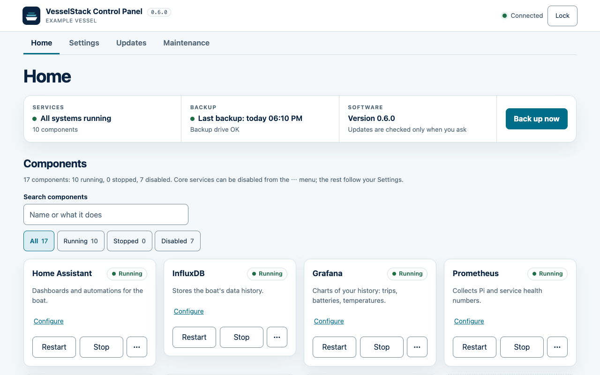
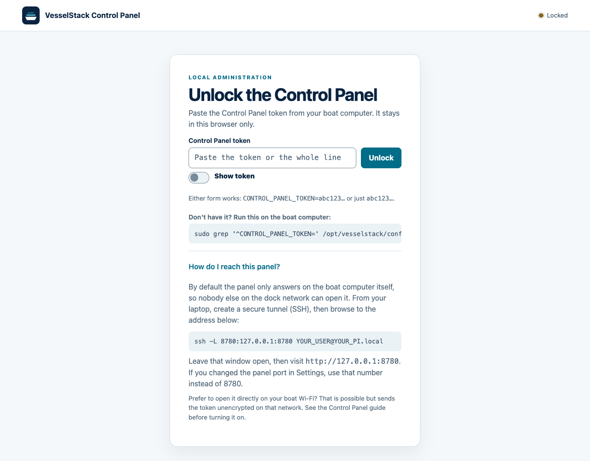
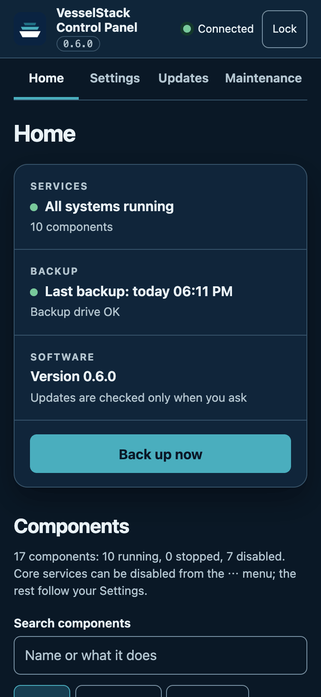
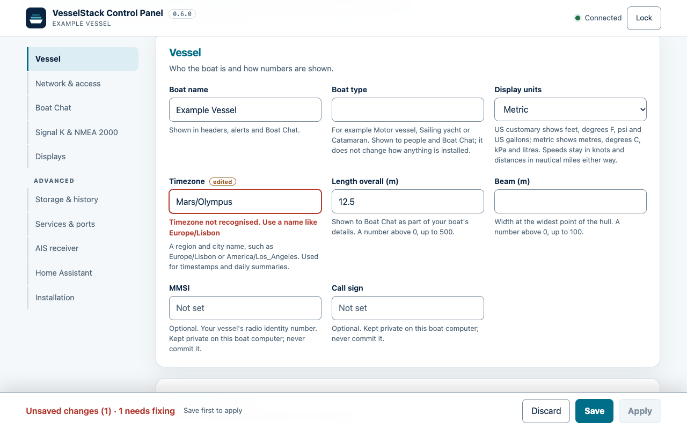
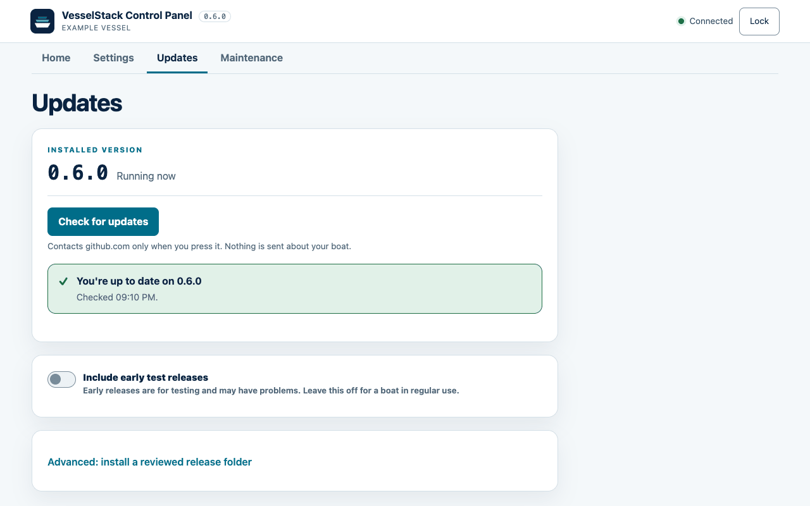
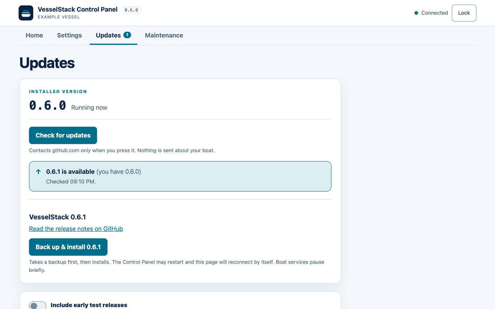
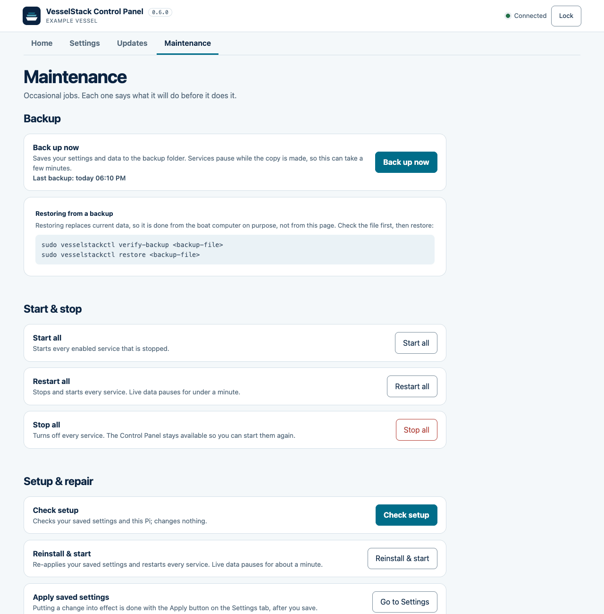
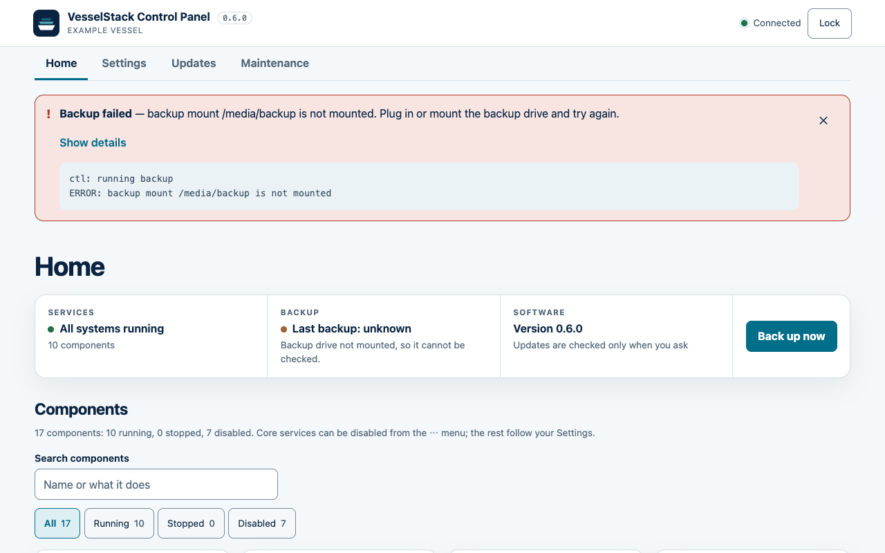
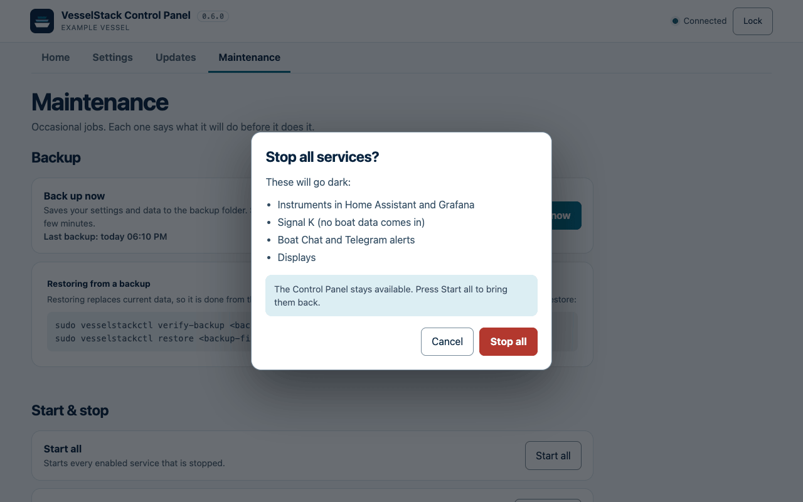

# Control Panel

Purpose: how to reach, secure, and use the Control Panel, tab by tab, and what to do when it will not connect. Lab acceptance steps are in [Control Panel lab testing](CONTROL_PANEL_TESTING.md).

[Back to README](../README.md) · [Documentation index](README.md)

The Control Panel is the browser page for looking after VesselStack. It shows
whether the stack is running, makes backups, edits settings, checks for and
installs updates, and runs the occasional repair. It stays available when the
rest of the stack is stopped, so you can start it again from the same page. The
`vesselstackctl` command remains the recovery path if the panel itself is
unavailable.



*Home: three status cells, one Back up now button, and the components.*

## Open the panel

By default the panel answers only on the boat computer itself. From your laptop,
open a secure tunnel (SSH), leave that window open, and browse to the local
address:

```bash
ssh -L 8780:127.0.0.1:8780 YOUR_USER@YOUR_PI.local
```

Then open `http://127.0.0.1:8780`. If you changed the panel port in Settings,
use that number instead of 8780. The tunnel keeps the token off the boat
network and is the recommended way in.

To open the panel directly from a laptop or phone on a trusted boat network,
preview and then apply only the panel listener:

```bash
sudo vesselstackctl panel-access lan --dry-run
sudo vesselstackctl panel-access lan
```

Open the address printed by the command (normally `http://PI_ADDRESS:8780`).
This is plain HTTP, so the token crosses that network unencrypted; use it only
on a network you trust. It exposes the panel listener only, not the rest of the
stack, and a strict firewall may still block it. `sudo vesselstackctl
panel-access local` restores the loopback-only default.

## Sign in



*The unlock screen. It explains how to read the token and how to reach the panel.*

Read the generated token on the Pi:

```bash
sudo grep '^CONTROL_PANEL_TOKEN=' /opt/vesselstack/config/control-panel.env
```

Paste the result into **Control Panel token** and press **Unlock**. Either form
works: the whole `CONTROL_PANEL_TOKEN=…` line or just the value after the equals
sign. **Show token** reveals what you pasted.

The token is kept in this browser tab's session storage, cleared by **Lock** or
when the tab closes, and sent only in the `X-VesselStack-Token` request header.
If you press **Lock** with unsaved Settings edits, the panel asks first, because
locking discards them.

## The four tabs

The header shows the installed version and a connection state (Connected,
Disconnected or Locked). The tabs are **Home**, **Settings**, **Updates** and
**Maintenance**. The Updates tab shows a number when an update is known.

On a phone the tabs and cards stack in one column, and the page follows the device's light or
dark setting.



*The Control Panel at phone width in dark mode.*

### Home

Home is for looking, not for changing.

- **Services** says "All systems running", or how many components are stopped
  and which ones.
- **Backup** shows when the last backup was made and whether the backup drive is
  mounted. It warns when there is no backup yet, when the drive is not mounted,
  when the folder is not writable, or when backups sit on the computer's own
  disk instead of an external drive.
- **Software** shows the installed version, or the newer version found by the
  last update check, with a link to the Updates tab. It never checks by itself.
- **Back up now** is the one action on this page. It runs `vesselstackctl backup`.

Below the status row, every component has a card with its plain name, a status
word (Running, Stopped, Disabled or Unknown) and what it does. Running
components offer **Restart** and **Stop**; stopped ones offer **Start**.
**Configure** jumps to that component's section in Settings. A **⋯** menu on a
core component holds **Disable**, which stops it, removes its container and
keeps it off, including after a restart or **Start all**. **Enable** brings it
back. Optional workers that are not core show **Turn on in Settings** instead.
The search box and the All, Running, Stopped and Disabled filters narrow the list.
Stopping, restarting and disabling a component ask in a dialog first.

### Settings



*Settings: a jump list, one section per topic, Advanced sections collapsed, and one save bar.*

Nothing changes on the boat until you press **Save** and then **Apply**.

- A jump list at the top goes to Vessel, Network & access, Boat Chat, Signal K &
  NMEA 2000, and Displays. Under **Advanced** it lists Storage & history,
  Services & ports, AIS receiver, Home Assistant and Installation. Advanced
  sections start collapsed; Installation is read-only here.
- Every field has plain help text. Mistakes show inline, next to the field. The
  server checks the timezone against the system's timezone list and every
  plain-number setting against its allowed range, and a save with any problem
  is rejected with a message per field, so nothing is half-saved.
- Secrets are write-only. The panel reports only whether one is set; leave a
  secret blank to keep its value, or use the explicit **Clear stored value**
  checkbox. Clearing an optional integration token disables that credential;
  clearing a required installer-managed password or token makes the installer
  generate a replacement the next time settings are applied, and dependent
  clients must then be updated.
- The save bar at the bottom shows how many changes are waiting. **Discard**
  resets the form to the saved values. **Save** writes the configuration
  atomically with mode 600 and keeps a rollback copy under
  `/opt/vesselstack-data/control-panel/config-backups/`; it does not restart
  anything. **Apply** then renders and installs the saved settings (see
  [Backup, update, apply and reinstall](#backup-update-apply-and-reinstall)).
- The Telegram and telemetry-indexer switches take effect when settings are
  applied. Configure the Telegram bot token and allowed chat IDs before enabling
  the worker. Disabled workers cannot be started from the component cards.
- Changing the panel's own listener or port takes effect when the panel
  restarts: use **Maintenance → Restart Control Panel**.

### Updates



*Updates: nothing is contacted until you press Check for updates.*

The tab shows the installed version and, if the running panel differs from it,
a note to restart the Control Panel. **Check for updates** is the only thing
that contacts `github.com`; nothing about your boat is sent. The result is
either "You're up to date" or the newer release with a link to its release
notes on GitHub and a **Back up & install** button.

**Include early test releases** adds GitHub prereleases to the check. They are
for testing; leave it off on a boat in regular use. The 0.5.x panels called the
same switch "Include lab prereleases"; an owner updating from 0.5.x uses that older name.

**Back up & install** asks in a dialog, then runs the update in a detached
worker so it survives the panel restarting. It:

1. downloads the release archive and its checksum file from GitHub and checks
   the size, the SHA-256 checksum and the digest GitHub reports;
2. unpacks it and runs the installer's checks (`--dry-run`);
3. takes a backup with `vesselstackctl backup --require-mounted`, so the update
   stops here if the backup drive is not mounted;
4. runs the new installer with `--config … --start`;
5. restarts the Control Panel and waits for it to report the new version.

The panel and the services may be interrupted for a few minutes. The page
reconnects by itself, and the banner confirms the new version. The panel checks
the archive against its published checksum; verifying the signed release tag is
a separate step you can run yourself (see
[Updating](UPDATING.md#verify-a-release-tag)).

**Advanced: install a reviewed release folder** is for a release you already
downloaded, checked and unpacked on the Pi under `/var/lib/vesselstack/releases`.
**Back up & update from folder** runs `vesselstackctl update FOLDER`, which
takes its own backup first.



*After a check, a newer release appears with its notes and a Back up & install button.*

### Maintenance



*Maintenance: occasional jobs, each described before you run it.*

| Group | Button | What it does | Command behind it |
|---|---|---|---|
| Backup | **Back up now** | Saves settings and data to the backup folder. Services pause while the copy is made, which can take a few minutes. | `vesselstackctl backup` |
| Start & stop | **Start all** | Starts every enabled service that is stopped. | `vesselstackctl start` |
| | **Restart all** | Stops and starts every service; live data pauses for under a minute. | `vesselstackctl restart` |
| | **Stop all** | Turns off every service. The Control Panel stays available. | `vesselstackctl stop` |
| Setup & repair | **Check setup** | Checks saved settings and this Pi; changes nothing. | `install.sh --config … --dry-run` |
| | **Reinstall & start** | Re-applies saved settings and restarts every service; live data pauses for about a minute. Unsaved Settings edits are not included. | `install.sh --config … --start` |
| | **Go to Settings** | Applying a change is done with **Apply** on the Settings tab. | none |
| History storage | **Provision history** | Creates the places where history is kept and the small job that builds one-minute averages. Safe to run again. | `installer/scripts/bootstrap-influx.sh` |
| Panel | **Restart Control Panel** | Restarts only the panel. Boat services keep running and the page reconnects in a few seconds. | detached `systemctl restart` of the panel service |

Restoring from a backup is deliberately not on this page. Restore replaces
current data, so do it from the boat computer:

```bash
sudo vesselstackctl verify-backup BACKUP_FILE
sudo vesselstackctl restore BACKUP_FILE --yes
```

Operation commands are fixed allowlisted argument arrays; the panel does not
expose an arbitrary shell. While one operation runs, the other buttons are
disabled so lifecycle changes cannot overlap.

## Results and confirmations

The result of the latest operation stays in a banner under the tabs until you
dismiss it. Success shows the time and, for a backup, where the file was saved;
failure shows the reason and what to try next. **Details** opens the command
output.



*The result banner after Back up now.*

Anything that stops or interrupts something asks first, in a dialog that lists
what is affected and has a plain **Cancel**.



*The Stop all dialog lists what will go dark and says the panel stays available.*

## Backup, update, apply and reinstall

| Action | Takes a backup | Changes software | Applies saved settings | Interrupts |
|---|---|---|---|---|
| **Back up now** | It is the backup | No | No | Services pause during the copy |
| **Apply** (Settings) | No | No | Renders and installs them; containers are not recreated | The displays bridge, if running, is restarted; other services keep running until restarted |
| **Reinstall & start** | No | No | Yes | Every service restarts, about a minute |
| **Back up & install** (Updates) | Yes, first, drive must be mounted | Yes, to the chosen release | Yes | Panel and services, a few minutes |

**Apply** runs `install.sh --config …` against your saved settings without
`--start`. That is the installer's render-only mode: it writes the rendered
configuration but does not recreate containers or restart Boat Chat, Telegram or
the Control Panel; it restarts only the displays bridge, if it is running. To make
a running service use the new values, restart that component from its Home card,
or use **Restart all** or **Reinstall & start**. (The Apply dialog's wording about
services restarting is broader than this; `install.sh` without `--start` is what
runs.) Hardware probes and the Signal K connectivity
check still gate installer actions.

## When the panel cannot connect

- **Disconnected.** The header says Disconnected and the page shows "Can't reach
  the boat computer". Controls are paused. The panel retries five times and then
  waits for **Retry now**. Check that the SSH tunnel window is still open and
  that the Pi is powered, then press **Retry now**. If the Pi was updating or
  restarting, it reconnects by itself and reloads when the panel has restarted.
  Unsaved Settings edits are kept and you are asked to save or discard them
  first.
- **Your session ended.** After a restart or a token change the panel returns
  to the unlock screen and says so. Paste the token again; unsaved edits are
  kept.
- **That token wasn't accepted.** Re-read the token on the Pi. A leftover space
  or an old token from before a reinstall is the usual cause.
- **Couldn't reach the Control Panel.** At the unlock screen this means the
  tunnel is closed or the panel is not running. Restart it from the Pi:

  ```bash
  sudo systemctl restart vesselstack-control-panel.service
  sudo vesselstackctl logs control
  ```
- **"A newer Control Panel is installed than the one running."** Press
  **Restart Control Panel** on the Maintenance tab.

The panel does not restart itself while an operation is running. After applying
a release that changes Control Panel code, restart it the same way.

## Telegram, indexer and host service

Inspect the optional workers with:

```bash
sudo vesselstackctl logs telegram
sudo vesselstackctl logs indexer
systemctl list-timers vesselstack-telemetry-indexer.timer
```

The service runs as root because Docker, systemd, installation, backup and
hardware operations require host privileges. Keep the token private, keep
loopback binding unless a trusted authenticated access layer is in place, and
never expose port `8780` to the internet. To disable the panel without
affecting telemetry services:

```bash
sudo systemctl disable --now vesselstack-control-panel.service
```

Re-enable it with `sudo systemctl enable --now vesselstack-control-panel.service`.
CLI configuration and lifecycle commands continue to work while it is disabled.
Optional workers and schedules follow the same guard: a start or restart from the
panel is rejected until the worker's enable flag is set. Offline setup checks
require the node-exporter image only when `NODE_EXPORTER_ENABLE=true`.

## Troubleshooting

| Symptom | Likely cause and fix |
|---|---|
| Back up now fails with a mount message | The backup drive is not mounted. Mount it, then try again; the Home tab shows the drive state. |
| Home says backups are on the computer's own disk | The backup folder is not on an external drive. Set **Backup folder** under Settings → Advanced → Storage & history to a path under `/media` or `/mnt`. |
| Save is rejected with field messages | Fix the marked fields (unknown timezone, number out of range) and save again. |
| Check for updates fails | The Pi has no route to `github.com`. Check its internet connection; offline boats use [the offline path](UPDATING.md). |
| A component shows Stopped with extra detail | The detail is the raw state, for example restarting. Open its log with `sudo vesselstackctl logs COMPONENT`. |
| A disabled component says it is still running | Press **Retry disabling**. |
