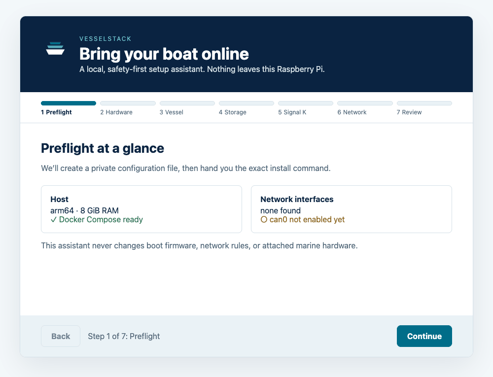
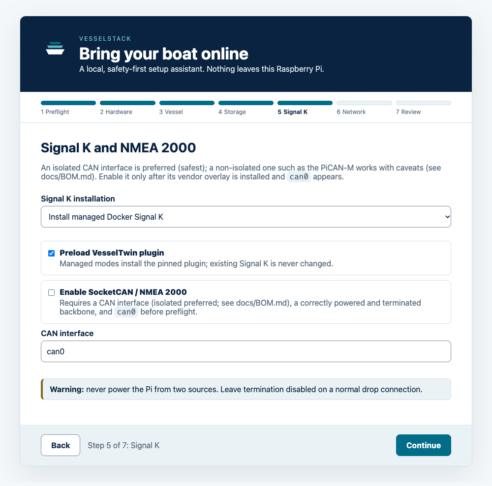
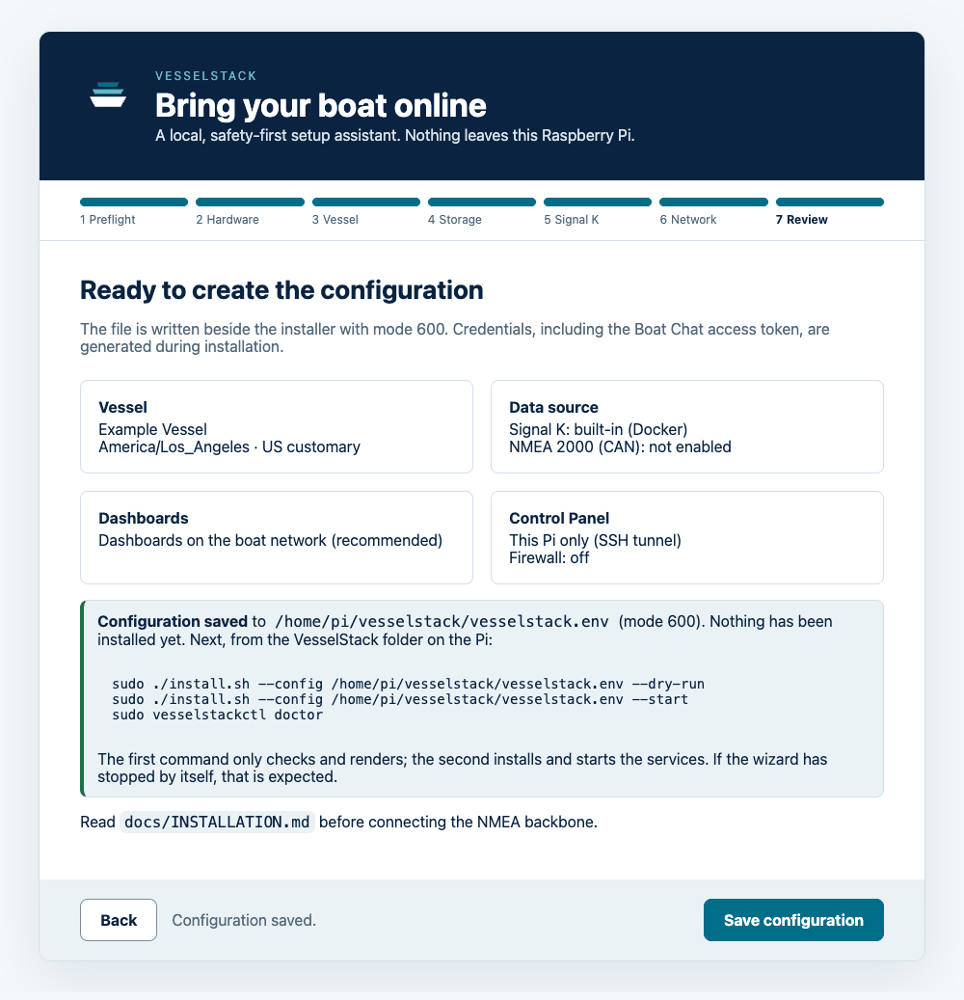
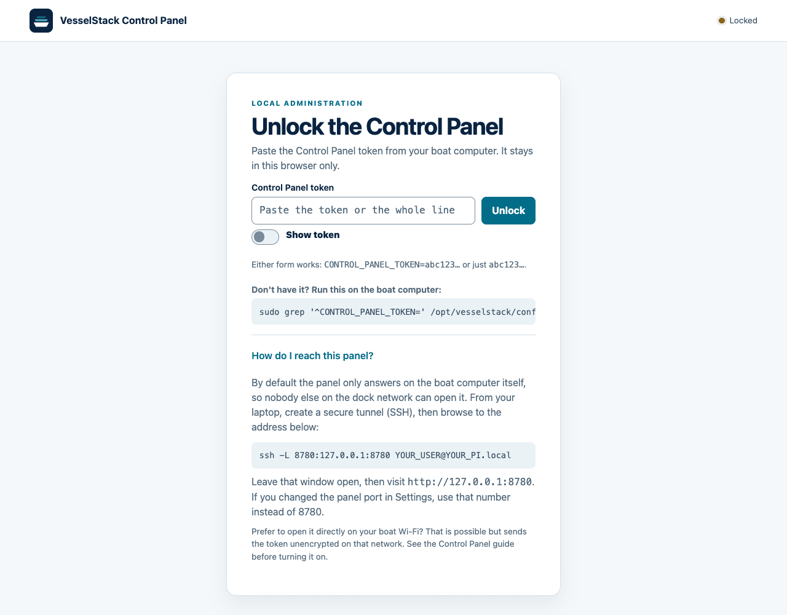

# Getting started

Start here to set up VesselStack on an existing Raspberry Pi or a new build.
For a complete hardware-to-commissioning run, use
[INSTALLATION.md](INSTALLATION.md).

## Before you begin

- A Raspberry Pi 4 or 5 running 64-bit Raspberry Pi OS (4 GB RAM minimum,
  8 GB recommended), or a supported Debian/Ubuntu host. On Raspberry Pi the
  installer expects `arm64`; a supported non-Pi host uses its native supported
  architecture. 32-bit Raspberry Pi OS is refused.
- A stable network connection for the first online install, preferably
  Ethernet, and a laptop or desktop with an SSH client.
- Storage with room for the operating system, containers, history, backups, and
  updates. An SSD is strongly preferred for time-series data.
- If using NMEA 2000, a compatible SocketCAN interface (isolated is preferred, safest; a
  non-isolated one such as the PiCAN-M works with caveats, see
  [BOM.md](BOM.md)), a powered and terminated backbone, and the vendor's Pi overlay configured before
  enabling CAN. VesselStack does not edit boot firmware or turn hardware on.
- A quiet commissioning window. Do not install or validate while underway, and
  do not use VesselStack as your only alarm or navigation system.

For a new Pi, start with the [BOM](BOM.md). For an existing Pi, check the
operating system, architecture, free space, Docker, and Compose before making
changes:

```bash
cat /etc/os-release
uname -m
dpkg --print-architecture
df -h /
docker --version
docker compose version
```

## First boot: online install

On an internet-connected Pi, the normal path is one SSH session and one guided
installer. `-t` gives the session a terminal so the installer can ask questions:

```bash
ssh -t YOUR_USER@raspberrypi.local
curl -fsSL https://github.com/jclima/VesselStack/releases/download/v0.6.2/get-vesselstack.sh | sudo bash
```

The URL pins release `v0.6.2`, so it installs that release whatever GitHub marks as Latest
(`--version 0.6.2` selects the same release). The form `.../releases/latest/download/get-vesselstack.sh`
points to whichever release GitHub marks Latest, which is not necessarily the newest one. For a
lab Pi and an offline boat, follow [DEPLOYMENT.md](DEPLOYMENT.md).

The script checks the host first. It asks before installing missing Debian
packages or Docker Engine and Compose v2 from Docker's official apt repository,
then downloads and checksum-verifies VesselStack, asks configuration questions,
and shows a review before starting. It needs `sudo` because it changes system
packages, services, and protected directories. Re-running an existing install
offers the supported update flow; it does not silently overwrite it.

The terminal wizard explains defaults and keeps secrets out of the review. Boat
name, units, timezone, Signal K, CAN, firewall, retention, network reachability,
and the optional Boat Chat provider are configured there. Boat Chat defaults to
a local provider. A remote provider is optional and may require internet and
provider credentials.

### The optional browser wizard

`--web-wizard` (or `python3 vesselstack-wizard.py` on its own) serves a browser version of the
same questions on loopback only. It prints a per-run address of the form
`http://127.0.0.1:PORT/#token=...`; open that exact address on the Pi, or from your laptop
through `ssh -L PORT:127.0.0.1:PORT YOUR_USER@YOUR_PI.local`. It has seven steps:
**Preflight**, **Hardware**, **Vessel**, **Storage**, **Signal K**, **Network** and **Review**.
**Back** keeps what you entered, and **Continue** stays blocked until the page has its address
token.



*Step 1, Preflight: host architecture and memory, Docker Compose, network interfaces and
whether `can0` is present. The checks are for information only.*

Steps 2 to 4 are a hardware checklist for your reference (not saved), the boat name, type,
timezone and units (US customary or metric; knots and nautical miles are always kept), and the
service account and paths. **Signal K** chooses a managed or existing server and, if you enable
NMEA 2000, the CAN interface:



*Step 5, Signal K and NMEA 2000: enable SocketCAN only after the vendor overlay is installed
and `can0` appears.*

**Network** asks who can reach the dashboards and who can open the Control Panel, with an optional
firewall for Wi-Fi. **Review** writes the file with mode 600; credentials, including the Boat
Chat access code, are generated later, during installation.



*The last page after saving: nothing is installed yet. Run the `--dry-run` command, then the
`--start` command, then `sudo vesselstackctl doctor`. If the wizard has stopped by itself, that is
expected.*

The terminal wizard asks the same things; its wording and values may differ slightly.

## How to access it

At the end, the installer prints the LAN addresses for Grafana, Home Assistant,
and Boat Chat. Open those addresses from a computer on the same trusted boat
network. Near the end it asks whether to set a Control Panel passphrase and a Boat Chat
crew passphrase (typed twice, hidden; just Enter skips) and whether to pair this phone or
laptop with a link and QR code. With `--yes` or `--defaults` it asks nothing and prints the commands
to do it later. The long access tokens still exist for scripts; keep them private and never
commit `config/*.env`.

## First sign-in to the Control Panel

The Control Panel is administration-only and binds to loopback by default. Reach it through an
SSH tunnel from your own computer:

```bash
ssh -L 8780:127.0.0.1:8780 YOUR_USER@PI
```

Then open `http://127.0.0.1:8780` and sign in with the passphrase you chose during installation
(tick **Remember this device** to skip it for 30 days). If you skipped it:

```bash
sudo vesselstackctl passphrase set panel   # choose a passphrase
sudo vesselstackctl panel-link             # or print a one-time link and QR code for a phone or laptop
```

The long token still works for scripts and as a fallback: `sudo grep '^CONTROL_PANEL_TOKEN='
/opt/vesselstack/config/control-panel.env` (paste it into the token box). If you changed the panel
port in Settings, use that number. Do not expose port 8780 directly to the internet.



A first look at each tab is in the [Control Panel guide](CONTROL_PANEL.md). Exact ports, LAN presets, firewall behavior, token storage, and
rollback are documented in [Network access and security](NETWORK.md) and the
[Control Panel guide](CONTROL_PANEL.md).

The SSH tunnel is the recommended default. Direct panel access from the boat network is an
opt-in choice: for a deliberate trusted-LAN setup, preview and apply only the panel listener:
`sudo vesselstackctl panel-access lan --dry-run`, then
`sudo vesselstackctl panel-access lan`. This is unencrypted HTTP on all
interfaces; a strict firewall may still block it. Roll back with
`sudo vesselstackctl panel-access local`. The command prints the token retrieval
command but never prints the token itself.

## Lab Pi versus boat Pi

Use an internet-connected home-lab Pi to stage and soak a release, test backup
and restore, and rehearse an update. A boat Pi can run without internet after
you carry in the release tarball, checksum, and matching offline bundle. Docker
and required Debian packages must be installed while the Pi is still online;
the offline installer cannot fetch them. Before leaving the lab, verify that
the matching offline bundle contains every required Python dependency and
container image.

Follow [DEPLOYMENT.md](DEPLOYMENT.md) for the pinned release workflow, offline
bundle verification, dock-side update, and rollback. Internet is not required
for the local Signal K/history/dashboard stack once its images and packages
are present. It may still be required by an explicitly selected remote Boat
Chat provider or another separately configured integration.

For a fresh offline managed Docker install, the default
`SIGNALK_VESSELTWIN_PRELOAD=true` requires a valid existing plugin to be
installed while online. If the plugin is absent, set
`SIGNALK_VESSELTWIN_PRELOAD=false` in the carried configuration before
installing offline; you can preload it later while online, and enabling,
pairing, and readings remain separate owner choices. Native Signal K is
unsupported offline. If `DISPLAYS_ENABLE=true`, provision the displays bridge
virtual environment on that Pi while it is online, or set
`DISPLAYS_ENABLE=false`. See the
[offline deployment path](DEPLOYMENT.md#simple-path-one-command) for the bundle
and verification details.

## Keep data private

VesselStack is local-first but not automatically isolated from every network:
choose LAN access deliberately, use the firewall guidance, protect SSH, and
keep generated tokens per host. Do not copy lab secrets to the boat. Do not
publish vessel positions, MMSIs, call signs, device identifiers, telemetry
databases, backups, logs, or environment files.

An optional VesselTwin connection uses the `signalk-vesseltwin` plugin, pairing,
and explicit reading opt-ins. Managed Docker/native Signal K installs preload the
pinned plugin package by default; that preload does not enable the plugin, pair
the account, or authorize readings. Consult the
[VesselTwin integration guide](VESSELTWIN.md)
and [VesselTwin](https://www.vesseltwin.io/) for maintenance documents, equipment and
logbook records.

## If something goes wrong

Start with the read-only checks in [Troubleshooting](../README.md#troubleshooting):
`sudo vesselstackctl status`, `sudo vesselstackctl doctor`, and `sudo vesselstackctl urls`,
then inspect the relevant service logs. Stop before changing CAN or boot settings if `can0` is
missing. For release failures, use the deployment backup and rollback path;
do not delete `/opt/vesselstack-data` while investigating.

For deeper manual setup, every variable, port, service, security note, and
rollback command remains in the [full README reference](../README.md#4-configure-the-vessel) and
[Network access and security](NETWORK.md).
