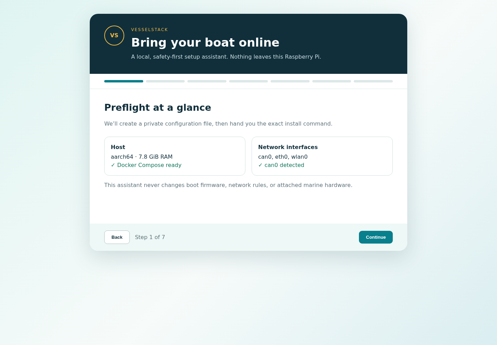
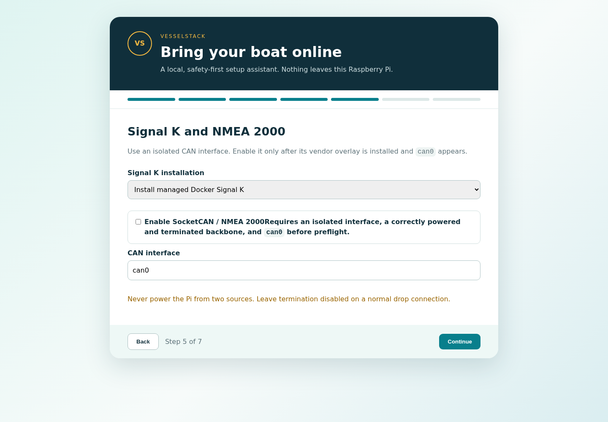

# End-to-end installation

This runbook takes a new Raspberry Pi from unopened hardware to a verified,
recoverable VesselStack installation. Budget a quiet half-day for the first
build; do not commission while underway.

## Quick path: one command

**Docker is installed for you.** If Docker Engine with the Compose v2 plugin is missing,
the script asks once and then follows Docker's official apt-repository instructions
(<https://docs.docker.com/engine/install/debian/>; the Ubuntu page for Ubuntu):

- it checks the system first: 64-bit Raspberry Pi OS, Debian 12 (bookworm) or 13
  (trixie), or Ubuntu; **32-bit Raspberry Pi OS (armhf) is refused** (see below);
- it downloads Docker's signing key over HTTPS, checks that the file holds exactly
  one key and that its fingerprint is `9DC8 5822 9FC7 DD38 854A  E2D8 8D81 803C 0EBF CD88`,
  and stops without changing anything if it does not match;
- it installs the key as `/etc/apt/keyrings/docker.asc`, writes
  `/etc/apt/sources.list.d/docker.sources` (Docker's deb822 entry for your release and
  CPU), runs `apt-get update` and installs `docker-ce docker-ce-cli containerd.io
  docker-buildx-plugin docker-compose-plugin`; it enables and starts the `docker`
  service and verifies `docker --version`, `docker compose version` (v2 or newer) and
  `docker info` (nothing is pulled);
- if Docker is already installed but the Compose plugin is missing, only
  `docker-compose-plugin` is added from the same repository;
- if Docker and Compose v2 are already present, it does nothing to Docker;
- unofficial packages that conflict with Docker's own (`docker.io`, `docker-cli`,
  `docker-compose`, `docker-compose-v2`, `docker-doc`, `docker-buildx`,
  `podman-docker`, `containerd`, `runc`) are **never removed silently**: the script
  lists the ones that are installed (plus any dependent packages apt would remove with
  them, taken from `apt-get -s remove`) and asks; `--yes` accepts. They are removed with
  `apt-get remove` (not purge), so `/var/lib/docker` is kept. If a Docker daemon
  already holds containers or volumes, `--yes` is not enough: the script stops, and you
  must confirm interactively (back up first) or remove the packages yourself;
- an older `docker.list` (the manual steps of v0.4.0) or any other apt source that
  already points at `download.docker.com` is renamed to `*.vesselstack-saved` after
  asking, because two entries with different keys make `apt-get update` fail;
- no `docker` group change is made: the installer runs as root and VesselStack's
  service account does not need Docker access;
- `--offline` cannot install Docker; install it first while online.

If a step fails, the script prints the failing command and what it left behind;
re-running is safe. **32-bit Raspberry Pi OS:** Docker Engine v28 was the last release
for it, so VesselStack needs 64-bit Raspberry Pi OS. Re-flash the card or SSD with
"Raspberry Pi OS (64-bit)" in Raspberry Pi Imager (Pi 3, 4, 5 and Zero 2 W support it);
`dpkg --print-architecture` must say `arm64` (`uname -m` can say `aarch64` on a 32-bit
system running a 64-bit kernel).

To undo the Docker part (your containers and data stay unless you delete them):

```bash
sudo apt-get remove docker-ce docker-ce-cli containerd.io docker-buildx-plugin docker-compose-plugin
sudo rm -f /etc/apt/sources.list.d/docker.sources /etc/apt/keyrings/docker.asc
sudo apt-get update
# optional, deletes ALL images, containers and volumes: sudo rm -rf /var/lib/docker /var/lib/containerd
```

Once the hardware is assembled, the operating system is installed (section 3) and
`can0` works if you use NMEA 2000 (section 4), SSH into the Raspberry Pi from your laptop
(`ssh -t YOUR_USER@raspberrypi.local`; the `-t` lets the installer ask its questions), paste
this one line and answer the questions in the same terminal. The Pi needs no screen,
keyboard or browser, and nothing has to be opened or tunnelled:

```bash
curl -fsSL https://github.com/jclima/VesselStack/releases/latest/download/get-vesselstack.sh | sudo bash
```

The terminal questions come in short sections (boat, Signal K, NMEA 2000 / CAN, AIS, Home
Assistant and Boat Chat, firewall, retention, network addresses). Each has a plain-language
explanation and a default in `[brackets]`: Enter accepts it, `?` explains, `b` goes back one
question, and a review screen (never showing secrets) lets you save, edit a section or quit.
Passwords and tokens are generated for you; MMSI, call sign and boat size are optional and
stay on the Pi. A short example:

```text
[1/9] Your boat
  Boat name [My Boat]: Sea Wolf
  Boat type [Motor vessel]:
  Units - choose 1-3 [metric]: 3
  Timezone [Europe/Oslo]:
  Add optional vessel details (MMSI, call sign, length, beam)? [y/N]:
...
  [s] save and continue   [e] edit a section   [q] quit without saving - choose [s]:
  Install and start VesselStack now? [Y/n]:
```

At the end the installer prints, as plain text for information, the service addresses to use
from another computer (Grafana, Home Assistant, Boat Chat), the command that shows the Boat
Chat access token and the SSH tunnel hint for the control panel
(`ssh -L 8780:127.0.0.1:8780 YOUR_USER@PI`).

**Without questions** (scripts, repeatable installs, or when no terminal is available):

```bash
curl -fsSL https://github.com/jclima/VesselStack/releases/latest/download/get-vesselstack.sh \
  | sudo bash -s -- --yes --set BOAT_NAME=Foo --set SOCKETCAN_ENABLE=true
```

`--yes` answers yes to every question and uses the defaults plus your `--set KEY=VALUE`
values (repeatable; names as in `vesselstack.example.env`; keep secrets out of `--set`, they
are generated). `--defaults` gives every question its own default and asks nothing (it does
not upgrade an installed system or remove Docker conflicts). `--config FILE` uses a ready-made
`vesselstack.env` (with `--set` overrides on top). With none of these and no terminal, the
installer stops before changing anything and lists these options. `--web-wizard` is the
optional browser wizard (loopback only; needs a browser on the Pi or an `ssh -L` tunnel).

The `latest` URL works only once a release carrying `get-vesselstack.sh` is marked latest.
Pinned to one release (works for any published release, including a pre-release): `.../releases/download/v0.4.4/get-vesselstack.sh`, or add
`--version 0.4.4` (`| sudo bash -s -- --version 0.4.4`). It installs the Debian
prerequisites, asks before installing Docker Engine and Compose v2 from Docker's official apt
repository (see the box above), downloads and checksum-verifies the
release, asks the configuration questions in the terminal, then runs the installer dry run, the
installation, `vesselstackctl doctor` and `vesselstackctl urls`. It shows a list of
everything it changed at the end and is safe to re-run. Sections 5 and 6 below are
the same steps done by hand ("advanced / manual").

**What this trusts.** `curl | sudo bash` runs a script from GitHub as root, so you
trust GitHub, TLS and the VesselStack release. The tarball's `.sha256` comes from
the same release: it catches corrupt or truncated downloads, not a compromised
release. Compare the sha256 the script prints with the one on the GitHub release
page, or pass `--sha256 HASH`. To read the script first (recommended for the first
install):

```bash
curl -fsSLO https://github.com/jclima/VesselStack/releases/latest/download/get-vesselstack.sh
less get-vesselstack.sh
sudo bash get-vesselstack.sh
```

Useful options: `--yes` (no questions), `--defaults`, `--set KEY=VALUE`, `--config FILE`
(`--no-wizard --config FILE`), `--web-wizard` (optional browser wizard) with `--wizard-port N`,
`--dir DIR`, `--offline --bundle DIR --tarball FILE` (no internet; see
[DEPLOYMENT.md](DEPLOYMENT.md)), `--help`. If VesselStack is already installed the
script reports an upgrade and offers `vesselstackctl update`; it never overwrites an
installation silently. Rollback: `sudo vesselstackctl stop`, and see the README
restore and uninstall sections; unpacked releases stay under
`/opt/vesselstack-release/` until you remove them.

## 1. Plan and buy

Use the [bill of materials](BOM.md). Before ordering the CAN interface, verify:

1. Raspberry Pi 5 support and a current 64-bit Raspberry Pi OS driver/overlay.
2. Galvanic isolation between CAN and the Pi.
3. Mechanical compatibility with the cooler, power hardware, and enclosure.
4. The vessel connector family and the correct drop cable/T-piece.
5. Whether the interface powers the Pi; design exactly one Pi power source.

Record the power circuit, fuse, device model, overlay lines, and rollback in the
boat's electrical documentation.

## 2. Assemble on the bench

Leave the NMEA backbone disconnected. Fit the Active Cooler, CAN interface, and
SSD according to their manufacturers. Check jumper voltage, oscillator, CAN
channel, and termination settings. The reference build uses the isolated NMEA
channel, 3.3 V logic where selectable, and termination **off** for a normal drop.

Use the official Pi supply during bench setup. Do not connect marine power at
the same time.

## 3. Install the operating system

With Raspberry Pi Imager, write the current 64-bit Raspberry Pi OS Lite to the
microSD. In Imager customization, set a unique hostname, non-default user,
strong password, timezone, SSH public key, and Wi-Fi only if needed. Boot with
Ethernet attached, then update once:

```bash
sudo apt update
sudo apt full-upgrade -y
sudo reboot
```

After reconnecting, the one-line installer installs the prerequisites itself
(`ca-certificates curl jq openssl python3 python3-venv rsync tar gzip`, and Docker
Engine/Compose v2 after asking) and creates the service account. For the manual
path, install them yourself, with Docker Engine/Compose from Docker's official
Debian instructions:

```bash
sudo apt install -y ca-certificates curl git jq openssl python3 python3-venv rsync
docker compose version
```

Create the dedicated account before installer preflight (the one-line installer
does this for you after confirmation):

```bash
sudo useradd --system --create-home --shell /usr/sbin/nologin boat
id boat
```

## 4. Enable the CAN interface

Follow the exact overlay and jumper instructions for the selected interface;
VesselStack intentionally does not edit boot firmware. Reboot, then verify:

```bash
ip -details link show can0
```

If `can0` is absent, stop here. Inspect `dmesg`, `/boot/firmware/config.txt`, the
overlay name, oscillator frequency, SPI assignment, and HAT vendor guide. Do
not enable `SOCKETCAN_ENABLE` until this succeeds.

## 5. Download and run the wizard (advanced / manual)

Skip sections 5 and 6 if you used the one-line installer.

```bash
git clone https://github.com/jclima/VesselStack.git
cd VesselStack
git checkout v0.4.4
python3 vesselstack-wizard.py --cli     # questions in the terminal, works over plain SSH
# python3 vesselstack-wizard.py         # the optional browser wizard (below)
```

`--cli` asks in the terminal and writes `vesselstack.env` (mode 600); `--defaults` and
`--set KEY=VALUE` skip the questions. For the browser wizard, on the Pi itself open the address the wizard prints (`http://127.0.0.1:8088/#token=...`; the token after `#` is required). For a headless Pi, keep the
wizard loopback-only and tunnel it from your workstation:

```bash
ssh -L 8088:127.0.0.1:8088 YOUR_USER@YOUR_PI
```

Then open the same printed address (with its `#token=...`) locally. The assistant inventories the host,
walks through the BOM and deployment choices, and writes `vesselstack.env` with
mode 600. Stop it with Ctrl-C when finished.





## 6. Preflight, install, and start

Review the generated file without sharing it publicly:

```bash
sudo ./install.sh --config vesselstack.env --dry-run
sudo ./install.sh --config vesselstack.env
sudo ./install.sh --config vesselstack.env --start
sudo vesselstackctl doctor
sudo vesselstackctl urls
```

The dry run must pass before installation. If Docker access is denied, follow
the Docker post-install guidance or run the documented commands with `sudo`.

## 7. Connect and commission NMEA 2000

Power down the Pi and the NMEA backbone. Connect one drop cable to a T-piece on
the existing backbone. Confirm the backbone already has two end terminators and
the new interface's terminator is off. Restore backbone and Pi power, then:

```bash
ip -statistics link show can0
sudo vesselstackctl status
```

In Signal K, add an NMEA 2000/SocketCAN connection using `can0`. Confirm RX
packets increase and expected navigation values appear. A rising error or
dropped counter is a wiring, bitrate, termination, power, or interface problem;
disconnect the new drop and correct it before proceeding.

## 8. Configure integrations and acceptance tests

Follow the root README for Home Assistant, Signal K, AIS, Grafana, and Boat Chat.
Before relying on the system:

- Reboot and confirm `sudo vesselstackctl doctor` passes.
- Turn off upstream internet and confirm local dashboards remain available.
- Simulate only safe sensor conditions and verify alarms on every intended
  device. Never create a real flooding, over-temperature, or low-voltage event.
- Run and verify a backup to separate media:

```bash
sudo vesselstackctl backup
sudo vesselstackctl verify-backup /path/to/archive.tar.gz
```

- Record the Pi hostname/IP, fuse location, power isolation point, CAN adapter,
  connector, installed version, backup location, and recovery owner.

## Reaching VesselStack from other devices

The wizard asks "Who should be able to reach the dashboards?": `local` (only this Pi; use an
SSH tunnel), `dashboards` (recommended: Grafana, Heimdall and Boat Chat on your boat network;
InfluxDB, Prometheus and MQTT stay on the Pi) or `all` (also MQTT, InfluxDB and Prometheus,
which has no login). Unattended: `--set LAN_ACCESS=dashboards`. Change it later with
`sudo vesselstackctl lan [local|dashboards|all] [--dry-run]` (`all` needs `--yes`). The
Control Panel stays on the Pi in every preset. SignalK and Home Assistant are host-networked
and not controlled by the presets; use the firewall's strict mode or Home Assistant's
`http: server_host` to limit them.

If `VESSELSTACK_FIREWALL_ENABLE=true` and the Pi is on your network over the untrusted
interface (default `wlan0`), other devices are blocked from Grafana and the data services
whatever the preset says; `vesselstackctl lan` warns and refuses (override:
`--allow-firewall-conflict`). Test from a laptop on the same network:

```bash
curl -sS -o /dev/null -w '%{http_code}\n' http://PI:43000/login   # 200 = Grafana reachable
```

See the README section "Reaching VesselStack from other devices" for the full table.

## Troubleshooting: Boat Chat "not ready" (memory index empty)

`vesselstackctl doctor` prints `FAIL Boat Chat memory index is empty` (or `/health`
shows `readiness.layers.memory` with `chunks: 0`) on installs older than 0.4.3,
which never built the index, or when the build failed. Fix it with
`sudo vesselstackctl reindex` (it runs as the service user), then `sudo vesselstackctl
doctor`. 0.4.3 and later build the index during installation, on upgrade and on
`vesselstackctl start`. Details: README, "Memory index".

## Troubleshooting: SignalK not running / EACCES on package.json

Prometheus metrics live in `<data>/prometheus` (owned by uid/gid 65534, created by the
installer, included in backups) and are kept for `PROMETHEUS_RETENTION` (default `30d`).
Releases before 0.4.4 used an anonymous Docker volume that is left untouched on upgrade;
the old history stays there until `docker volume prune`. See the README section
"Prometheus data and retention".

With `SIGNALK_MODE=docker`, if the `vesselstack-signalk` container keeps restarting
and `sudo docker logs vesselstack-signalk` shows
`EACCES: permission denied, open '/home/node/.signalk/package.json'`, the data
directory `<data>/signalk` is owned by root instead of uid/gid 1000 (the `node`
user in the SignalK image). Release 0.4.3 and later create and repair it on every
installer run (an empty or `root:root` directory only; a populated directory with symlinks,
hard links, special files or another owner is left untouched with instructions), and
`sudo vesselstackctl doctor` reports it. Manual fix:

```bash
sudo chown -R 1000:1000 /opt/vesselstack-data/signalk && sudo docker restart vesselstack-signalk
```

## Rollback and recovery

Before NMEA commissioning, rollback is simply: power down, disconnect the new
drop at its T-piece, and restore backbone power. For software rollback, stop the
stack with `sudo vesselstackctl stop`; preserve `/opt/vesselstack-data` and the
latest verified backup. See the README's update, restore, and uninstall sections
before changing or removing persistent data.
