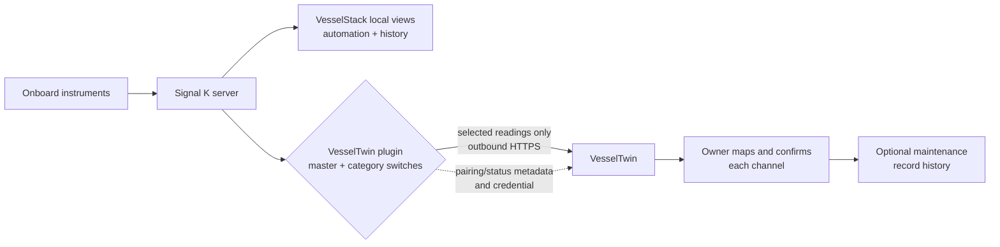

# Optional VesselTwin connection

VesselStack is the onboard system for monitoring, automation, local history, and
Boat Chat. VesselTwin is a separate, private place for maintenance documents,
equipment, and logbook records. VesselStack does **not** have a built-in,
automatic VesselTwin connector.

If you choose to connect them, the supported path is the separate
[VesselTwin Signal K plugin](https://github.com/jclima/signalk-vesseltwin). It
can send selected sensor values from your Signal K server to your VesselTwin
account. Pairing is optional, and pairing by itself does not send readings.

## Before you install anything

Check the account and rollout first:

- You need a VesselTwin account and a plan that includes the Signal K
  integration. In the current rollout this is normally the Owner Pro plan, but
  buying a plan alone is not a guarantee that the integration is enabled for
  your account.
- Sign up or check your account at the [VesselTwin home page](https://www.vesseltwin.io/).
  Use the home page rather than bookmarking a direct signup route.
- In VesselTwin, open **Settings > Integrations > SignalK**. If SignalK is not
  available there, stop and ask about access before installing the plugin.
- The upstream plugin currently requires **Node.js 20.3 or newer** and a
  **Signal K 2.x** server. Those are upstream requirements, not a promise that
  every Signal K version pinned by a VesselStack image is supported. Check the
  [plugin's current requirements](https://github.com/jclima/signalk-vesseltwin#requirements)
  before upgrading a managed installation.

Do not assume that the Signal K Appstore listing is present immediately. If it
is not listed, use the upstream installation instructions and identify the
configuration directory used by your actual Signal K service first. Managed
roots, containers, and mounted volumes differ. Do not blindly run an npm
install in `~/.signalk`; back up the Signal K administrator configuration before
changing it. VesselStack's existing install and first-boot guidance is in
[INSTALLATION.md](INSTALLATION.md) and [GETTING_STARTED.md](GETTING_STARTED.md).

## How the connection works

The plugin sends selected engine or generator hours, battery voltage or state
of charge, and tank level or volume. It does not provide remote equipment
control, and it does not require inbound port forwarding: communication is
outbound HTTPS from Signal K.

Pairing and status still involve a network connection, pairing metadata, and a
stored credential. Before readings are enabled, no sensor readings are sent.
The plugin's closed reading allowlist does not read or upload position tracks,
AIS, MMSI, call signs, vessel or crew names, or free text. Treat the plugin data
directory and administrator account as private.

## Owner setup

Do this while safely alongside, with Signal K security enabled and an
administrator session open.

1. In the Signal K admin UI, open **Appstore** and search for **VesselTwin**.
   If it is available, install it and restart the Signal K server. Then open
   **Server > Plugin Config** and enable the **VesselTwin** plugin.
2. Open **Webapps > VesselTwin** and choose **Pair**. The admin-only page shows
   a link and a short link code. Open the displayed link, sign in to VesselTwin,
   enter the code, choose the boat, and approve it. The code expires after 10
   minutes.
3. Wait for the page to say **Paired with …**. Pairing alone sends no readings.
4. Return to **Server > Plugin Config > VesselTwin**. Turn on the master switch
   **Send readings to VesselTwin**, then explicitly choose the categories you
   want. Engine/generator hours, battery readings, and tank levels are off by
   default.
5. For each category, choose **All instances** or **Only the ids listed**.
   Prefer the narrow list when you know which engine, battery bank, or tank you
   want. Save the settings.
6. In VesselTwin, open the boat **Details > Sensor channels** panel. Map each
   channel to the proper equipment or boat-level meter. For an engine or
   generator runtime channel, compare the sensor value with the current physical
   hour-meter reading. If they differ, explicitly choose the offset you want;
   the plugin does not calibrate it automatically. Then choose **Confirm**. A
   transmitted value is not written to the maintenance record until you
   complete this step.

Signal K must publish a current runtime sample before the plugin can send an
engine or generator channel. That sample is separate from the owner's physical
gauge/hour-meter baseline: Signal K supplies the channel value, and the owner
confirms the real-world starting reading in VesselTwin.

| Setting | What it controls | Safe starting choice |
|---|---|---|
| Send readings to VesselTwin | Master permission for all reading uploads | Off until paired and ready to send selected readings |
| Engine and generator hours | Runtime-hour channels | Enable only the engines/generators you recognize |
| Battery readings | Voltage and state of charge | Select the intended bank(s) |
| Tank levels | Level and volume | Select the intended tank(s) |
| Record from | All instances or named Signal K instance ids | Named ids when possible |

The default behavior is periodic record collection, not a live VesselTwin
dashboard mirror. The upstream plugin documents a bounded local waiting queue:
while sending is enabled, values are retained for up to seven days or 50,000
readings, with the oldest dropped first. Turning sending off or unpairing clears
waiting values, so do not describe this as unlimited offline storage. VesselStack's local
monitoring, automation, and history can continue when the internet is down if
those local services are configured; the cloud connection cannot.

## Privacy and disconnecting

The integration is outbound-only. It does not open an inbound port and does not
control equipment. Pairing credentials are created during pairing and stored by
the plugin in its private data directory with restrictive permissions; do not
paste credentials into plugin settings, tickets, or chat.

To disconnect, choose **Unpair** in **Webapps > VesselTwin** and confirm. That
removes the local connection, but it does not revoke the connection shown in
VesselTwin. Remove or revoke the boat connection there as a separate step.

## Troubleshooting

| What you see | What to check |
|---|---|
| The Appstore has no VesselTwin entry | Confirm Signal K and Node requirements, then follow the [upstream install instructions](https://github.com/jclima/signalk-vesseltwin#install) for the actual managed configuration directory. |
| Pairing is unavailable or account access is denied | Recheck **Settings > Integrations > SignalK** and the account plan/rollout. A paid plan does not by itself prove access is enabled. |
| It says paired, but no readings arrive | Confirm the master switch, the desired category switches, and the instance filters. Pairing alone sends nothing. |
| A new engine, battery, or tank is missing | Check that Signal K is publishing a current value under a selected instance id, then save the plugin settings and wait for the next value. |
| Values arrive but are not in the record | Open **Sensor channels** in VesselTwin, map each channel to equipment, and **Confirm** it. |
| It stopped after a restart | Check the Signal K plugin status and wait briefly for the next instrument value. Verify Signal K's clock, network, and the account connection before re-pairing. |
| You want to stop sending temporarily | Turn off **Send readings to VesselTwin** and save. Remember that queued waiting values are cleared when sending is off. |

## About this guide

Use the upstream [signalk-vesseltwin GitHub repository](https://github.com/jclima/signalk-vesseltwin)
and the [VesselTwin home page](https://www.vesseltwin.io/) for current
requirements and behavior. Appstore listing and account availability may vary;
verify the first reading in a safe lab or dockside session before relying on
the connection aboard.
